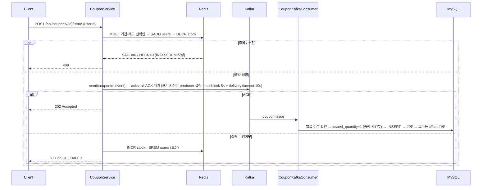

# Phase 4 — Redis 판정 → Kafka ACK 확인 → DB. 뼈대만

선착순 쿠폰 발급의 최소 구성이다. 발급 판정은 Redis, 영속화는 Kafka 뒤의 Consumer, 그리고 "Kafka에 갔는지"를 응답 전에 확정한다.
브로커 ACK(`acks=all`)를 받으면 202, 못 받으면 Redis 예약을 되돌리고 503.

처음엔 Lua 한 번으로 예약과 이벤트 기록을 묶고 Redis Stream을 outbox로 쓰는 버전을 만들었다(커밋 `2432d73`).
멘토링(2026-10-25)에서 "KV outbox는 복잡해지고, 어차피 있는 Kafka를 쓰면 된다"는 피드백을 받아 Stream·Lua를 걷어냈고,
리팩토링 3회(`726c768`·`2d76bc3`·`cd2dfe6`) 뒤 발급 경로와 무관한 것(모니터링 스택, 할인·사용·조회 기능, 미사용 엔티티)을 전부 뺐다.



## 구성

| 파일 | 역할 |
| --- | --- |
| `api/CouponController` | `POST /{id}/issue`(202) · `GET /{id}/stock` · `POST /{id}/stock/init` |
| `api/CouponIssueRequest` · `ApiResponse` · `exception/*` | `userId` 필수 검증(compact 생성자), 공통 응답, 에러 코드 → HTTP 상태 |
| `service/CouponService` | 선확인 → 예약 → 발행. 발행 실패 시 `rollback` + 503 + WARN 로그 |
| `service/CouponRedisService` | `coupon:{id}:stock / users / startDate / endDate`. MGET 선확인, SADD → DECR, INCR + SREM 보상 |
| `service/CouponKafkaProducer` | `send().join()` — 브로커 ACK 대기. 타임아웃은 yml만 소유 |
| `service/CouponKafkaConsumer` | 발급 여부 확인 → `issued_quantity < total_quantity` 조건부 UPDATE → INSERT. `@Transactional` 뒤 offset 커밋 |
| `domain/Coupon` · `IssuedCoupon` | `coupon(total_quantity, issued_quantity, start_date, end_date)` · `issued_coupon(coupon_id, user_id, issued_at)` + 유니크 제약 |
| `event/CouponIssueEvent` | `(couponId, userId, issuedAt)` record. JSON 직렬화 |
| `docker-compose.yml` | MySQL · Redis(AOF) · Kafka(KRaft 단일 노드) |
| `reset-coupon.sh` · `k6/concurrent-issue.js` · `report.sh` | 쿠폰 초기화 · 1,000명 동시 요청 · Redis users = DB rows = issued_quantity 대조 |

## 멘토링 피드백 반영 — 2026-10-25

| 피드백 | 반영 |
| --- | --- |
| Redis Stream(KV) outbox는 복잡해진다. 어차피 Kafka가 있으니 있는 걸 써라 | Stream·relay 제거. API가 Kafka에 직접 발행하고 ACK를 확인한다 |
| Lua 스크립트 단점? | Lua 제거. SADD → DECR 분리 + 보상으로 되돌림. 단점은 아래 정리 |
| 비동기로 돌리면 남는 게 없다. 로그로 남겨라 | 발행 실패→보상, DB 총량 거부, 중복 건너뜀을 모두 WARN/INFO 로그로 남긴다 |
| primary ↔ replica는 세 포인트만 | 비동기 복제라 승인 직후 유실 가능 · RDB/AOF 스냅샷으로 복구 · `WAIT`으로 복제 완료까지 대기(지연 증가). 더 깊게는 자소서 범위 밖 |
| API ↔ MySQL 요청 원장 부하는 Kafka로 | request/pending 토픽 분리, wait→request→pending→done 상태 전이. **요청 원장이 있는 실험 모듈의 후속 과제**이며 이 모듈에는 원장이 없다 |

### 공유한 설계도("발급부터 Outbox 정리까지")와의 대응

| 설계도 단계 | 이 모듈 |
| --- | --- |
| 1. 발급 확정 — Redis 발급 기록 + Outbox를 함께 확정 후 응답 | Outbox 없음. 대신 Kafka ACK를 **동기로** 확인한 뒤 응답. 응답 지연에 ACK 시간이 포함된다 |
| 2. Relay → Kafka → Consumer, DB 커밋 후 offset 커밋 | Relay 없음(API가 직접 발행). Consumer의 "DB 커밋 → offset 커밋" 순서는 동일(`enable-auto-commit=false` + `@Transactional`) |
| 3. DB 확인 후 Outbox 정리 | 해당 없음 |
| 4. 조회 API의 Redis 캐시 | 조회 API 자체를 두지 않았다 |

설계도의 열린 질문 "Lua 없이 발급 기록과 Outbox를 함께 확정하는 방법"에 대한 답:
`MULTI/EXEC`는 쓰기 묶음은 원자적으로 만들지만 **판정**(중복이면 차감하지 않는다)을 묶지 못한다. 중복 사용자도 DECR이 실행되고 INCR로 되돌려야 하며,
되돌리기 전에 죽으면 재고가 샌다. 조건부 원자성은 Lua(또는 `WATCH` 낙관적 재시도)에서만 나온다. 그래서 Lua를 뺀 이 모듈은 창을 열어 두고 보상 + DB 총량 가드로 막는다.

### Lua 스크립트의 단점 (멘토 질문)

- 실행 중 Redis 단일 스레드를 독점한다. 느린 스크립트 하나가 모든 클라이언트를 멈춘다.
- 중간에 오류가 나도 앞서 실행한 쓰기는 롤백되지 않는다. 트랜잭션이 아니라 "끼어들지 못함"일 뿐이다.
- 디버깅·테스트가 어렵다. 실제 Redis가 있어야 하고 스택 트레이스가 Java 쪽에 없다.
- 배포 단위가 하나 더 생긴다. 스크립트 버전·`NOSCRIPT`(재시작·failover 후 캐시 소실) 처리가 필요하다.
- Cluster에서는 다루는 키가 전부 같은 슬롯이어야 한다(해시 태그 강제).

## 실행

```bash
docker compose up -d --wait                       # MySQL 3306 · Redis 6379 · Kafka 9092
cd spring && ./gradlew bootRun
./reset-coupon.sh 1 100                           # DB 쿠폰 생성 + Redis 재고 초기화
k6 run -e COUPON_ID=1 -e USERS=1000 k6/concurrent-issue.js
./report.sh 1                                     # Redis users == DB rows == issued_qty 대조
cd spring && ./gradlew test                       # 동시 1,000명 · 동일 사용자 100회 · 발행 실패 보상 · 400 포맷 (인프라 필요)
```

호스트 6379를 다른 컨테이너가 쓰고 있으면 override로 포트만 바꾼다:

```bash
printf 'services:\n  redis:\n    ports: !override\n      - "6380:6379"\n' > /tmp/redis-port.yml
docker compose -f docker-compose.yml -f /tmp/redis-port.yml up -d --wait
SPRING_DATA_REDIS_PORT=6380 ./gradlew bootRun     # 테스트도 같은 환경변수로
```

## 측정 — 2026-10-25

k6 1,000 VU `shared-iterations`, 재고 100, Apple Silicon 1대에 앱·인프라 동거. 절대 성능이 아니라 동작 확인용.

| 항목 | 리팩토링 전 | 리팩토링 3회 후 | 뼈대만 |
| --- | ---: | ---: | ---: |
| 처리량 | 3,878 req/s | 3,966 req/s | 5,040 req/s |
| 응답 p95 / 평균 | 211.96 / 154.38 ms | 210.09 / 127.84 ms | 183.24 / 105.40 ms |
| 발급 성공 / 정상 탈락 / 초과 발급 | 100 / 900 / 0 | 100 / 900 / 0 | 100 / 900 / 0 |
| Redis 명령 수 (요청 1,000건, `INFO commandstats`) | 5,800 (계산) | 1,540 | 1,600 (MGET 1,000 · SADD/DECR 400 · INCR/SREM 200) |
| Redis users = DB rows = issued_quantity | 100 = 100 = 100 | 100 = 100 = 100 | 100 = 100 = 100 |

세 열은 같은 날 같은 기계지만 실행 간 편차가 있다. 성공 100건의 응답에는 Kafka ACK 대기가 포함된다(p95 ≈ 185 ms).

**Kafka 중단 실험** — `docker stop kafka` 후 재고 5 쿠폰에 요청 1건: 10.0초 뒤 503(`delivery.timeout.ms=10000`), Redis `stock=5 · users=0`으로 되돌아갔다.

## 남은 한계

- **SADD 뒤 DECR 전 크래시** — 그 사용자만 `users`에 남아 재시도가 DUPLICATED가 된다(재고는 그대로). 닫으려면 Lua나 outbox가 필요하다.
- **DECR 뒤 ACK 전 크래시** — 보상이 돌지 못해 재고 1·사용자 1이 샌다. 확률은 낮지만 0이 아니다. 복구는 `users` 집합과 DB 발급 내역을 대조하는 정리 작업(설계도 3단계)의 몫이다.
- **실패 응답 지연** — Kafka가 죽어 있으면 503까지 10초 걸린다. 더 줄이면 일시 지연을 실패로 오판한다.
- **Redis 복제** — 비동기라 primary 장애 시 승인된 예약이 사라질 수 있다. `WAIT`·스냅샷 복구는 위 피드백 표의 세 포인트까지만.
