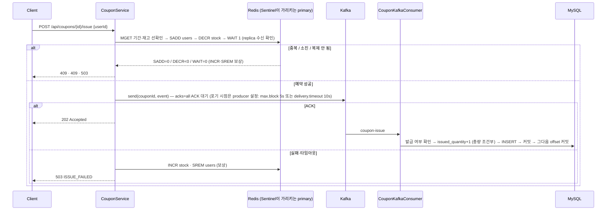

# Phase 4 `4-coupon_redisHA_kafka` — Redis(Sentinel) 판정 → Kafka ACK 확인 → DB. 뼈대만

선착순 쿠폰 발급의 최소 구성이다. 발급 판정은 Redis, 영속화는 Kafka 뒤의 Consumer, 그리고 "Kafka에 갔는지"를 응답 전에 확정한다.
브로커 ACK(`acks=all`)를 받으면 202, 못 받으면 Redis 예약을 되돌리고 503.

처음엔 Lua 한 번으로 예약과 이벤트 기록을 묶고 Redis Stream을 outbox로 쓰는 버전을 만들었다(커밋 `2432d73`).
멘토링(2026-10-25)에서 "KV outbox는 복잡해지고, 어차피 있는 Kafka를 쓰면 된다"는 피드백을 받아 Stream·Lua를 걷어냈고,
리팩토링 3회 뒤 발급 경로와 무관한 것(모니터링 스택, 할인·사용·조회 기능, 미사용 엔티티)을 전부 뺐다.

`redisHA`: Redis는 primary 1 · replica 1 · Sentinel 3이다. 앱은 Sentinel에게 primary를 묻고 failover 뒤 자동으로 옮겨 붙는다. 예약은 replica가 받은 뒤(`WAIT`)에만 승인한다 — 끄면 failover 때 승인된 예약이 사라지는 것을 실험으로 확인했다 ([Redis HA](#redis-ha--2026-10-26)).



## 구성

| 파일 | 역할 |
| --- | --- |
| `api/CouponController` | `POST /{id}/issue`(202) · `GET /{id}/stock` · `POST /{id}/stock/init` |
| `api/CouponIssueRequest` · `ApiResponse` · `exception/*` | `userId` 필수 검증(compact 생성자), 공통 응답, 에러 코드 → HTTP 상태. 저장소 연결 실패(`DataAccessException`)·복제 미확인은 503 |
| `service/CouponService` | 선확인 → 예약 → 발행. 발행 실패 시 `rollback` + 503 + WARN 로그 |
| `service/CouponRedisService` | `coupon:{id}:stock / users / startDate / endDate`. MGET 선확인, SADD → DECR → WAIT(replica 수신 확인), INCR + SREM 보상 |
| `service/CouponKafkaProducer` | `send().join()` — 브로커 ACK 대기. 타임아웃은 yml만 소유 |
| `service/CouponKafkaConsumer` | 발급 여부 확인 → `issued_quantity < total_quantity` 조건부 UPDATE → INSERT. `@Transactional` 뒤 offset 커밋 |
| `domain/Coupon` · `IssuedCoupon` | `coupon(total_quantity, issued_quantity, start_date, end_date)` · `issued_coupon(coupon_id, user_id, issued_at)` + 유니크 제약 |
| `event/CouponIssueEvent` | `(couponId, userId, issuedAt)` record. JSON 직렬화 |
| `docker-compose.yml` | MySQL · Redis primary/replica + Sentinel 3(네임스페이스 공유, `127.0.0.1:6381/6382`, `26379~26381`, AOF) · Kafka(KRaft 단일 노드) |
| `reset-coupon.sh` · `k6/concurrent-issue.js` · `report.sh` | 쿠폰 초기화 · 1,000명 동시 요청 · Redis users = DB rows = issued_quantity 대조 (Redis 명령은 Sentinel이 가리키는 primary로) |
| `failover.sh` | primary kill → Sentinel 승격 → 다시 승인되기까지의 시간과 응답, `lag`로 복제 지연 중 승인 예약의 소실 여부 |

## 멘토링 피드백 반영 — 2026-10-25

| 피드백 | 반영 |
| --- | --- |
| Redis Stream(KV) outbox는 복잡해진다. 어차피 Kafka가 있으니 있는 걸 써라 | Stream·relay 제거. API가 Kafka에 직접 발행하고 ACK를 확인한다 |
| Lua 스크립트 단점? | Lua 제거. SADD → DECR 분리 + 보상으로 되돌림. 단점은 아래 정리 |
| 비동기로 돌리면 남는 게 없다. 로그로 남겨라 | 발행 실패→보상, DB 총량 거부, 중복 건너뜀을 모두 WARN/INFO 로그로 남긴다 |
| primary ↔ replica는 세 포인트만 | 구현·실험 ([Redis HA](#redis-ha--2026-10-26)): 비동기 유실 → 예약 직후 `WAIT`로 replica 수신을 확인한 뒤 승인 · 스냅샷 복구 → 양쪽 AOF, 옛 primary는 full resync · 복제 대기 비용 → 건강할 땐 19 µs, replica가 없으면 승인 정지 |
| API ↔ MySQL 요청 원장 부하는 Kafka로 | request/pending 토픽 분리, wait→request→pending→done 상태 전이. **요청 원장이 있는 [실험 모듈](../5-coupon_experiments/README.md)의 후속 과제**이며 이 모듈에는 원장이 없다 |

### 공유한 설계도("발급부터 Outbox 정리까지")와의 대응

| 설계도 단계 | 이 모듈 |
| --- | --- |
| 1. 발급 확정 — Redis 발급 기록 + Outbox를 함께 확정 후 응답 | Outbox 없음. 대신 Kafka ACK를 **동기로** 확인한 뒤 응답. 응답 지연에 ACK 시간이 포함된다 |
| 2. Relay → Kafka → Consumer, DB 커밋 후 offset 커밋 | Relay 없음(API가 직접 발행). Consumer의 "DB 커밋 → offset 커밋" 순서는 동일(`enable-auto-commit=false` + `@Transactional`) |
| 3. DB 확인 후 Outbox 정리 | 해당 없음 |
| 4. 조회 API의 Redis 캐시 | 조회 API 자체를 두지 않았다 |

설계도의 열린 질문 "Lua 없이 발급 기록과 Outbox를 함께 확정하는 방법"에 대한 답:
`MULTI/EXEC`는 쓰기 묶음은 원자적으로 만들지만 **판정**(중복이면 차감하지 않는다)을 묶지 못한다. 중복 사용자도 DECR이 실행되고 INCR로 되돌려야 하며,
되돌리기 전에 죽으면 재고가 샌다. 조건부 원자성은 Lua(또는 `WATCH` 낙관적 재시도)에서만 나온다. 그래서 Lua를 뺀 이 모듈은 창을 열어 두고 보상 + DB 총량 가드로 막는다.

### Lua 스크립트의 단점 (멘토 질문)

- 실행 중 Redis 단일 스레드를 독점한다. 느린 스크립트 하나가 모든 클라이언트를 멈춘다.
- 중간에 오류가 나도 앞서 실행한 쓰기는 롤백되지 않는다. 트랜잭션이 아니라 "끼어들지 못함"일 뿐이다.
- 디버깅·테스트가 어렵다. 실제 Redis가 있어야 하고 스택 트레이스가 Java 쪽에 없다.
- 배포 단위가 하나 더 생긴다. 스크립트 버전·`NOSCRIPT`(재시작·failover 후 캐시 소실) 처리가 필요하다.
- Cluster에서는 다루는 키가 전부 같은 슬롯이어야 한다(해시 태그 강제).

## Redis HA — 2026-10-26

| 구성 | 내용 |
| --- | --- |
| 토폴로지 | primary(6381) · replica(6382) · Sentinel 3(26379~26381, quorum 2, `down-after-milliseconds 2000`). 다섯 컨테이너가 `redis-net`의 네트워크 네임스페이스를 공유해 서로를 `127.0.0.1:<port>`로 본다. Sentinel이 알려주는 주소가 컨테이너 안에서도 호스트의 앱에서도 같아야 하기 때문이다 (Docker Desktop에서 Sentinel을 쓰는 가장 짧은 길) |
| 앱 연결 | `spring.data.redis.sentinel` — Lettuce가 Sentinel에게 primary를 묻고, `+switch-master`를 받으면 새 primary로 옮겨 붙는다. 코드 변경 없음 |
| 영속성 | 양쪽 AOF `everysec`. failover 뒤 돌아온 옛 primary는 Sentinel이 replica로 되돌리고 새 primary에서 full resync한다 — 옛 primary만 갖고 있던 쓰기는 버려진다 |
| 복제 확인 | 예약(SADD·DECR) 직후 `WAIT 1 1000`. replica가 그 시간 안에 받지 못하면 INCR·SREM으로 되돌리고 `503 REPLICATION_TIMEOUT`. `coupon.redis.wait-replicas=0`이면 끈다 |

### failover 실험 (`./failover.sh`, 재고 10)

primary를 `docker kill`하고 0.2초 간격으로 발급을 시도한다. 죽인 노드는 5초 뒤 재기동한다(supervisor 흉내).

| | WAIT 1 (기본) | WAIT 없음 |
| --- | --- | --- |
| 정상 복제 중 kill → 다시 202 | **10.5 s** — Sentinel 승격(≈3 s)만으론 부족하고 옛 primary가 replica로 돌아와야 WAIT가 통과한다 | **4.9 s** — Sentinel 승격 직후 |
| 그동안의 응답 | 503 `STORE_UNAVAILABLE`(연결 끊김) → 503 `REPLICATION_TIMEOUT`(replica 없음, 요청당 1 s) | 503 `STORE_UNAVAILABLE` |
| kill 전에 승인된 1~5 | 살아남음 (재요청 409) | 살아남음 (재요청 409) |

복제 지연(`./failover.sh lag`): replica를 멈추고 복제 연결을 끊은 채 1~5를 발급한 뒤 primary를 죽인다.

| | WAIT 1 (기본) | WAIT 없음 |
| --- | --- | --- |
| 1~5 발급 | **503 ×5** — 복제 확인이 안 되니 승인하지 않는다 (요청당 1 s) | **202 ×5** |
| failover 뒤 Redis | stock=10 users=0 — 잃은 게 없다 | stock=10 users=0 — **승인한 5건이 사라졌다** (Kafka에는 이미 갔고 DB에는 저장됐다) |
| 이어서 11~25 발급 | Redis 승인자 = DB 발급자 = {6, 11~19} | Redis가 {6, 11~19}를 승인했지만 DB 총량 가드가 15~19를 거부한다 — **5명은 202를 받고 쿠폰이 없다**. 1~5는 쿠폰이 있는데 Redis는 모른다 |

`docker pause`만으로는 지연이 재현되지 않았다. 멈춘 프로세스 대신 커널 소켓 버퍼가 복제 스트림을 받아 두었다가 풀리는 순간 적용한다. 그래서 `CLIENT KILL TYPE replica`로 연결까지 끊는다.

### WAIT 비용 (k6 1,000명 `per-vu-iterations`, 재고 100)

| | WAIT 1 | WAIT 없음 |
| --- | ---: | ---: |
| 처리량 | 4,983 req/s | 4,967 req/s |
| p95 / 평균 | 182.96 / 108.09 ms | 188.93 / 92.89 ms |
| WAIT 호출 | 100회, 평균 19 µs | — |

replica가 건강하면 WAIT는 공짜에 가깝다. 비용은 replica가 없거나 느릴 때 나온다 — WAIT가 공유 커넥션을 timeout(1 s)만큼 막아 모든 요청이 직렬화되고, failover 뒤에는 replica가 돌아올 때까지 승인이 멈춘다.
"복제될 때까지 primary를 세운다"의 값이 이것이고, 어디서 멈출지(`wait-replicas`·`wait-timeout-ms`, 또는 서버 쪽 `min-replicas-to-write`)가 멘토가 말한 "적당한 선"이다.

## 실행

```bash
docker compose up -d --wait                       # MySQL 3306 · Redis 6381/6382 + Sentinel 26379~26381 · Kafka 9092
(cd spring && ./gradlew bootRun)                  # 별도 터미널. WAIT 끄고 비교하려면 --args='--coupon.redis.wait-replicas=0'
./reset-coupon.sh 1 100                           # DB 쿠폰 생성 + Redis 재고 초기화
k6 run -e COUPON_ID=1 -e USERS=1000 k6/concurrent-issue.js
./report.sh 1                                     # Redis users == DB rows == issued_qty 대조
./failover.sh                                     # primary kill → 다시 승인까지. ./failover.sh lag 는 복제 지연 중 승인 소실 실험
(cd spring && ./gradlew test)                     # 동시 1,000명 · 동일 사용자 100회 · 발행 실패 보상 · 400 포맷 (인프라 필요)
```

Redis는 6381/6382를 쓰므로 6379를 점유한 다른 컨테이너와 겹치지 않는다. 컨테이너 이름(`redis-primary`/`redis-replica`)과 역할은 failover를 거치며 바뀐다 — 스크립트는 Sentinel에게 물어 현재 primary로 간다.

## 측정 — 2026-10-25 · 10-26

k6 1,000 VU, 재고 100, Apple Silicon 1대에 앱·인프라 동거. 절대 성능이 아니라 동작 확인용.
앞 세 열은 `shared-iterations`(총 1,000회), 마지막 열은 리뷰에서 바꾼 `per-vu-iterations`(VU당 정확히 1회 → 서로 다른 사용자 1,000명 보장)다. executor가 다르면 VU 기동이 섞인 처리량은 비교할 수 없다.

| 항목 | 리팩토링 전 | 리팩토링 3회 후 | 뼈대만 | 리뷰 반영 (per-vu) |
| --- | ---: | ---: | ---: | ---: |
| 처리량 | 3,878 req/s | 3,966 req/s | 5,040 req/s | 2,394 req/s |
| 응답 p95 / 평균 | 211.96 / 154.38 ms | 210.09 / 127.84 ms | 183.24 / 105.40 ms | 177.73 / 54.06 ms |
| 발급 성공 / 정상 탈락 / 초과 발급 | 100 / 900 / 0 | 100 / 900 / 0 | 100 / 900 / 0 | 100 / 900 / 0 |
| Redis 명령 수 (요청 1,000건, `INFO commandstats`) | 5,800 (계산) | 1,540 | 1,600 | 1,600 (MGET 1,000 · SADD/DECR 400 · INCR/SREM 200) |
| Redis users = DB rows = issued_quantity | 100 = 100 = 100 | 100 = 100 = 100 | 100 = 100 = 100 | 100 = 100 = 100 |

같은 기계라도 실행 간 편차가 있다. 성공 100건의 응답에는 Kafka ACK 대기가 포함된다(p95 ≈ 180 ms).

**Kafka 중단 실험** — `docker stop kafka` 후 재고 5 쿠폰에 요청 1건: 10.0초 뒤 503(`delivery.timeout.ms=10000`), Redis `stock=5 · users=0`으로 되돌아갔다.

## 남은 한계

- **SADD 뒤 DECR 전 크래시** — 그 사용자만 `users`에 남아 재시도가 DUPLICATED가 된다(재고는 그대로). 닫으려면 Lua나 outbox가 필요하다.
- **DECR 뒤 ACK 전 크래시** — 보상이 돌지 못해 재고 1·사용자 1이 샌다. 확률은 낮지만 0이 아니다. 복구는 `users` 집합과 DB 발급 내역을 대조하는 정리 작업(설계도 3단계)의 몫이다.
- **Consumer 재시도 한도** — DB 쓰기가 예외로 끝나면 컨테이너(DefaultErrorHandler 기본값)가 같은 레코드를 10회 다시 넣고, 그 뒤엔 로그만 남기고 건너뛴다. DLT가 없어 DB 장애가 길면 그 이벤트는 사라진다.
- **실패 응답 지연** — Kafka가 죽어 있으면 503까지 10초 걸린다. 더 줄이면 일시 지연을 실패로 오판한다.
- **failover 뒤 승인 공백** — WAIT 1이면 replica가 돌아올 때까지(실측 10.5 s) 모든 발급이 503이다. replica를 2대 두면 한 대 장애에서 공백이 사라진다.
- **WAIT가 공유 커넥션을 막는다** — replica가 없거나 느리면 요청당 timeout만큼 직렬화된다. WAIT만 별도 커넥션(풀)으로 빼면 풀린다.
- **failover 중 요청 대기** — Lettuce는 끊긴 동안 명령을 쌓아 뒀다가 새 primary로 보낸다. 첫 요청이 5~6 s 걸렸다. `disconnectedBehavior=REJECT_COMMANDS`나 짧은 command timeout으로 빨리 실패시키는 선택이 있다.
- **WAIT를 끄면 승인 예약 소실** — 위 실험대로 Redis가 잊은 사용자와 202만 받은 사용자가 생긴다. 복구는 Redis `users`와 DB 발급 내역을 대조하는 정리 작업의 몫이다.
- **Sentinel 토폴로지는 로컬용** — 네임스페이스 공유는 Docker Desktop에서 호스트의 앱을 붙이기 위한 트릭이다. 실제 배포에서는 Sentinel이 announce하는 주소가 앱에서 그대로 닿아야 한다.
