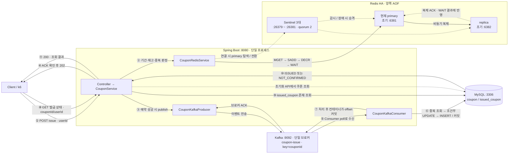
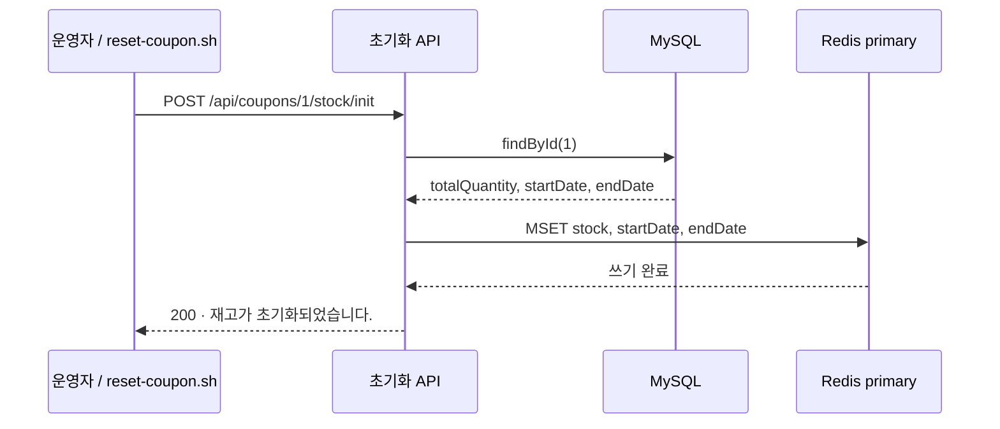
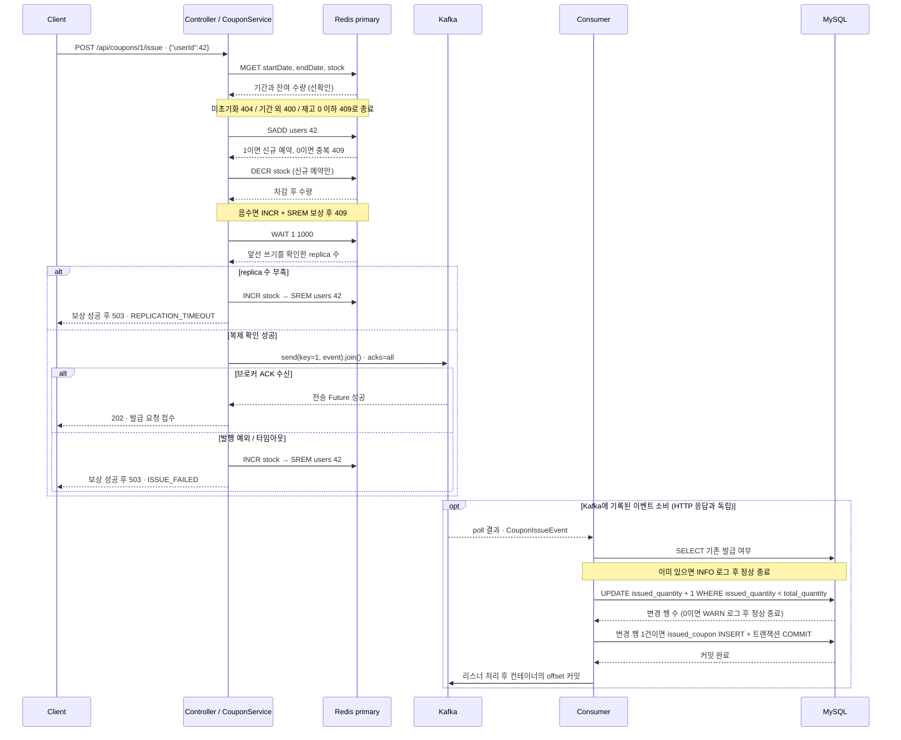
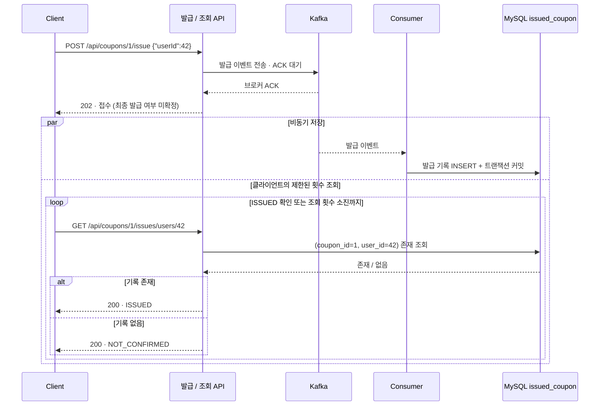
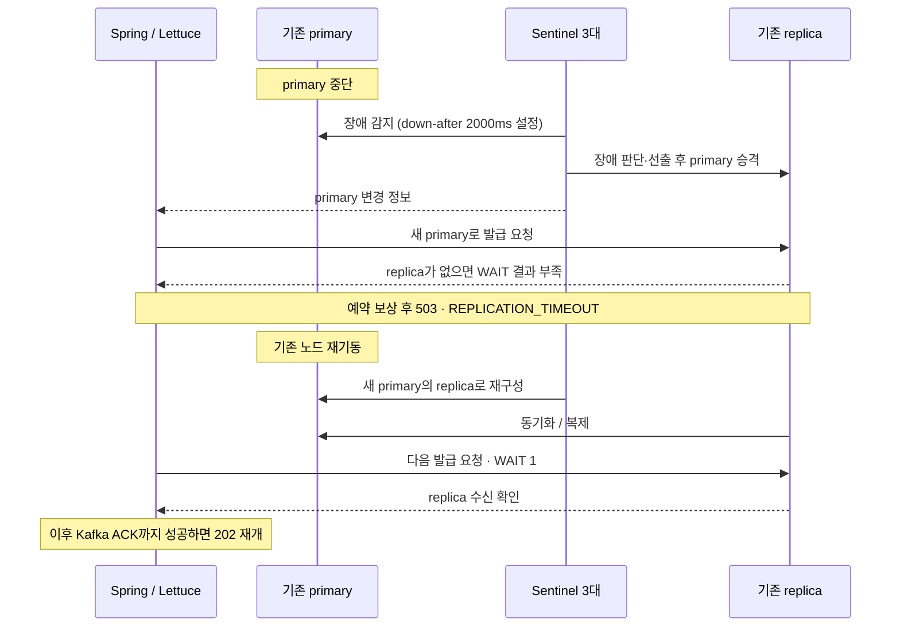

# Phase 4 — Redis HA 예약 → Kafka 접수 → MySQL 발급 저장

**클라이언트는 Redis 예약·복제 확인과 Kafka 브로커 ACK가 끝나면 `202 Accepted`를 받습니다. 최종 DB 저장은 Consumer가 별도로 수행합니다.** 클라이언트는 이후 발급 상태 조회 API로 MySQL에 발급 기록이 생겼는지 확인합니다. `202`는 DB 발급 완료를 뜻하지 않으며, HTTP 응답과 Consumer의 DB 커밋 중 어느 쪽이 먼저 끝나는지는 고정되지 않습니다.

[전체 아키텍처](#전체-아키텍처) · [요청과 응답](#요청과-응답) · [장애 처리](#장애-처리) · [Redis HA 실험](#redis-ha--2026-10-26) · [실행](#실행) · [남은 한계](#남은-한계)

## 전체 아키텍처

Controller·Service·Producer·Consumer는 **하나의 Spring Boot 프로세스** 안에 있습니다. HTTP 발급 경로는 Redis와 Kafka에 접근하고, Consumer가 MySQL에 최종 발급 내역을 저장합니다. 별도 조회 API는 MySQL의 발급 기록을 읽습니다. Sentinel은 primary 주소 탐색·승격을 담당하며 Redis 명령을 대신 전달하는 프록시는 아닙니다.



[Mermaid 크게 보기](../docs/architecture/phase-4-architecture.mmd) · [SVG 이미지로 보기](../docs/assets/phase-4-architecture.svg)

| 저장 위치 | 데이터와 의미 |
| --- | --- |
| Redis | `coupon:{id}:stock`(예약 가능 수량), `users`(예약 사용자 집합), `startDate`·`endDate`(기간). `users`는 DB 저장 완료 목록이 아닙니다 |
| Kafka | `coupon-issue`에 `{couponId, userId, issuedAt}` JSON 저장. 키는 `couponId`이며, `issuedAt`은 Producer가 이벤트를 만든 시각입니다 |
| MySQL | `coupon.issued_quantity`는 최종 발급 수량, `issued_coupon`은 사용자별 최종 발급 기록. 같은 트랜잭션에서 갱신합니다 |

`acks=all`은 현재 ISR의 ACK를 기다리는 설정입니다. 이 Compose는 **Kafka 단일 브로커**이므로 Kafka 복제본 장애 전환까지 구성한 것은 아닙니다. Redis의 `WAIT 1 1000`은 앞선 쓰기의 복제 수신 확인이며 디스크 영속화나 모든 장애에서의 무손실을 보장하지 않습니다.

모든 쿠폰 이벤트는 `coupon-issue` 토픽을 공유하며, `key=couponId`는 파티션 선택 기준입니다. 쿠폰별 토픽이나 파티션을 생성하는 것은 아닙니다. [Kafka 토픽·파티션 구조 이미지](../docs/assets/phase-4-kafka-topic.svg)

## 요청과 응답

### 1. 실험 준비: DB 쿠폰 → Redis 초기화

`./reset-coupon.sh 1 100`은 DB 쿠폰을 생성하거나 수량을 초기화하고, 해당 쿠폰의 DB 발급 기록과 Redis 키를 삭제한 뒤 아래 API를 호출합니다. 이전 요청·Consumer 처리가 끝난 상태에서 실행합니다.



[Mermaid 크게 보기](../docs/architecture/phase-4-initialize.mmd) · [SVG 이미지로 보기](../docs/assets/phase-4-initialize.svg)

**초기화 API 자체는 `users`를 삭제하지 않고 `issued_quantity`도 차감하지 않습니다.** DB의 총량을 그대로 Redis에 덮어쓰므로 진행 중인 쿠폰의 복구 API로 사용할 수 없습니다. 해당 API에는 `WAIT`도 없습니다.

### 2. 발급 요청: Redis 예약 → Kafka ACK → 202



[Mermaid 크게 보기](../docs/architecture/phase-4-issue.mmd) · [SVG 이미지로 보기](../docs/assets/phase-4-issue.svg)

`MGET`은 빠른 탈락을 위한 사전 조회입니다. 동시 요청이 모두 같은 재고를 읽을 수 있으므로 실제 예약은 `SADD` 반환값과 `DECR` 결과로 판정합니다. 선확인을 먼저 하므로 이미 소진된 쿠폰에 대한 중복 요청도 `DUPLICATED` 대신 `EXHAUSTED`가 될 수 있습니다.

DB 트랜잭션과 Kafka offset 커밋은 별개입니다. DB 저장 후 offset 커밋 전에 종료되면 이벤트가 다시 전달될 수 있어, Consumer는 기존 발급 조회와 DB 유니크 제약으로 중복을 방어합니다. offset은 Kafka 자동 커밋 대신 Spring 리스너 컨테이너가 관리하며, 레코드별 수동 ACK나 DB·Kafka 통합 트랜잭션은 설정하지 않았습니다.

### 3. 클라이언트의 최종 발급 확인



[Mermaid 크게 보기](../docs/architecture/phase-4-status.mmd) · [SVG 이미지로 보기](../docs/assets/phase-4-status.svg)

발급 조회는 **해당 쿠폰·사용자의 MySQL 발급 기록**을 읽습니다. `ISSUED`는 DB에 기록이 있다는 뜻입니다. `NOT_CONFIRMED`는 조회 시점에 기록이 없다는 뜻이며, 처리 중·최종 거부·이벤트 유실을 구분하지 않습니다. 이 API는 POST별 요청 ID나 이력을 추적하지 않습니다. 같은 쿠폰·사용자의 기존 발급 기록이 있으면 어떤 POST 뒤에 조회해도 `ISSUED`입니다. 조회 실패로 MySQL에 접근할 수 없으면 `503 STORE_UNAVAILABLE`입니다.

클라이언트는 `202`를 받은 뒤 간격을 두고 제한된 횟수만 조회합니다. 끝까지 `NOT_CONFIRMED`이면 발급 실패로 확정하지 말고 **결과 확인 불가**로 표시합니다. 조회를 반복하면 MySQL 읽기 부하가 늘어나므로 실제 서비스에서는 호출 간격·최대 횟수를 정해야 합니다. 이 저장소에는 클라이언트 폴링 코드가 포함되어 있지 않습니다.

### 4. API 계약과 호출 예시

| 요청 | 접근 대상 | 성공 응답의 `data` |
| --- | --- | --- |
| `POST /api/coupons/{id}/issue` + `{"userId":42}` | Redis → Kafka | `202`, `"쿠폰 발급 요청이 접수되었습니다."` |
| `GET /api/coupons/{id}/issues/users/{userId}` | MySQL `issued_coupon` 존재 조회 | `200`, `"ISSUED"` 또는 `"NOT_CONFIRMED"` |
| `GET /api/coupons/{id}/stock` | Redis `GET stock` | `200`, 정수 잔여 예약 수량 |
| `POST /api/coupons/{id}/stock/init` | MySQL 조회 → Redis `MSET` | `200`, `"재고가 초기화되었습니다."` |

```bash
curl -i -X POST http://localhost:8080/api/coupons/1/issue \
  -H 'Content-Type: application/json' -d '{"userId":42}'
curl -i http://localhost:8080/api/coupons/1/issues/users/42
curl -i http://localhost:8080/api/coupons/1/stock
```

접수 성공 (`202`):

```json
{"success":true,"data":"쿠폰 발급 요청이 접수되었습니다.","message":null}
```

DB에 발급 기록이 있을 때 조회 응답 (`200`):

```json
{"success":true,"data":"ISSUED","message":null}
```

아직 발급 기록이 없을 때 조회 응답 (`200`):

```json
{"success":true,"data":"NOT_CONFIRMED","message":null}
```

재고 소진 (`409`):

```json
{"success":false,"data":null,"message":"쿠폰이 모두 소진되었습니다."}
```

아래 장애 표의 `EXHAUSTED` 같은 이름은 **내부 에러 enum 이름**입니다. 에러 응답에는 별도 `code` 필드 없이 `message`만 들어갑니다. `ISSUED`·`NOT_CONFIRMED`는 조회 API의 `data` 값입니다. 실험용 `report.sh`는 수량을 비교할 뿐 불일치를 자동으로 복구하지 않습니다.

## 장애 처리

### 요청 처리 중 거절·장애

| 발생 지점 / 조건 | 현재 코드의 처리 | 클라이언트 응답 |
| --- | --- | --- |
| JSON 오류·`userId` 누락 | 역직렬화 단계에서 거절, Redis/Kafka 호출 없음 | `400 INVALID_REQUEST` |
| Redis 기간·재고 키 없음 | DB로 대체 조회하지 않고 종료 | `404 NOT_FOUND` |
| 발급 기간 외 | 쓰기 없이 종료 | `400 NOT_AVAILABLE` |
| MGET 재고 ≤ 0 | 쓰기 없이 종료 | `409 EXHAUSTED` |
| SADD = 0 | 기존 예약 유지, DECR 실행 안 함 | `409 DUPLICATED` |
| DECR < 0 | `INCR stock` → `SREM users` 보상 | 보상 성공 시 `409 EXHAUSTED` |
| WAIT 결과 < 1 | 같은 보상 후 Kafka 발행 생략 | 보상 성공 시 `503 REPLICATION_TIMEOUT` |
| Redis 연결·명령 실패 | `DataAccessException` 또는 WAIT의 `CompletionException`을 저장소 오류로 변환. 중간 쓰기는 남을 수 있음 | `503 STORE_UNAVAILABLE` |
| Kafka 전송 예외·ACK 타임아웃 | 예약 보상 후 WARN 로그. `max.block.ms=5000`, `delivery.timeout.ms=10000` 등으로 대기 제한 | 보상 성공 시 `503 ISSUE_FAILED` |
| 보상 중 Redis 실패 | INCR/SREM 사이에서 중단될 수 있음. 별도 재시도·복구 원장 없음 | `DataAccessException`이면 `503 STORE_UNAVAILABLE`; 원래 실패 응답보다 먼저 전파됨 |

**Kafka ACK를 못 받았다고 이벤트가 없다고 단정할 수 없습니다.** 브로커가 기록한 뒤 ACK만 유실됐다면 API는 예약을 보상하고 `503`을 반환해도 Consumer가 발급할 수 있습니다. DB 총량 가드는 초과 발급만 막으며, 실패 응답을 받은 사용자의 발급을 취소하거나 접수한 모든 사용자에게 발급을 보장하지는 않습니다.

### 접수 이후 Consumer·인프라 장애

| 상황 | 구현된 처리 | 남는 상태 / 한계 |
| --- | --- | --- |
| 동일 이벤트 재전달 | 기존 발급이면 INFO 로그 후 종료. 경합은 `(coupon_id, user_id)` 유니크 제약으로 방어 | INSERT 실패 시 같은 트랜잭션의 수량 증가도 롤백 |
| DB 총량 소진·쿠폰 없음 | 조건부 UPDATE가 0행이면 WARN 로그 후 정상 종료 | 이벤트 재시도·Redis 보상 없음. `202` 이후에도 최종 발급이 없을 수 있음 |
| DB 쓰기 예외 | DB 트랜잭션 롤백 후 컨테이너 기본 오류 처리기로 재전달 | 별도 재시도 정책·DLT 미설정. 기본 복구 처리가 레코드를 건너뛰면 자동 DB 반영은 끝남 |
| API 프로세스가 예약 중 종료 | 예외 핸들러와 보상이 실행되지 않음 | SADD만 남거나 재고까지 차감된 예약이 남음. 자동 대조·복구 작업 없음 |
| Redis primary 장애 | Sentinel 감지·승격 → Lettuce가 새 primary로 연결 | 연결 중단은 503. 승격 후에도 replica가 없으면 WAIT 실패로 503 |
| 복제 지연 | WAIT로 수신 확인되지 않은 예약을 보상하고 거절 | WAIT를 끄면 승인한 예약이 failover 때 소실될 수 있음 |
| Kafka 브로커 장애 | Producer 타임아웃 후 예약 보상, Consumer 처리 지연 | 단일 브로커라 다른 브로커로 자동 전환하지 않음 |



[Mermaid 크게 보기](../docs/architecture/phase-4-failover.mmd) · [SVG 이미지로 보기](../docs/assets/phase-4-failover.svg)

위 처리는 코드의 경로 설명입니다. 아래 실험 결과는 명시된 커밋·실행 조건에서 관측한 값이며, 문서를 갱신하면서 실험을 다시 실행하지는 않았습니다.

## 구성

| 파일 | 역할 |
| --- | --- |
| `api/CouponController` · `CouponIssueStatus` | `POST /{id}/issue`(202) · `GET /{id}/issues/users/{userId}`(DB 발급 조회) · `GET /{id}/stock` · `POST /{id}/stock/init` |
| `api/CouponIssueRequest` · `ApiResponse` · `exception/*` | `userId` 필수 검증(compact 생성자), 공통 응답, 에러 코드 → HTTP 상태. 저장소 연결 실패(`DataAccessException`)·복제 미확인은 503 |
| `service/CouponService` | 선확인 → 예약 → 발행. 발행 실패 시 `rollback` + 503 + WARN 로그. 별도 조회에서 DB 발급 기록 확인 |
| `service/CouponRedisService` | `coupon:{id}:stock / users / startDate / endDate`. MGET 선확인, SADD → DECR → WAIT(replica 수신 확인), INCR + SREM 보상 |
| `service/CouponKafkaProducer` | `send().join()` — 브로커 ACK 대기. 타임아웃은 yml만 소유 |
| `service/CouponKafkaConsumer` | 발급 여부 확인 → `issued_quantity < total_quantity` 조건부 UPDATE → INSERT. `@Transactional` 뒤 offset 커밋 |
| `domain/Coupon` · `IssuedCoupon` | `coupon(total_quantity, issued_quantity, start_date, end_date)` · `issued_coupon(coupon_id, user_id, issued_at)` + 유니크 제약 |
| `event/CouponIssueEvent` | `(couponId, userId, issuedAt)` record. JSON 직렬화 |
| `docker-compose.yml` | MySQL · Redis primary/replica + Sentinel 3(네임스페이스 공유, `127.0.0.1:6381/6382`, `26379~26381`, AOF) · Kafka(KRaft 단일 노드) |
| `reset-coupon.sh` · `k6/concurrent-issue.js` · `report.sh` | 쿠폰 초기화 · 1,000명 동시 요청 · Redis users = DB rows = issued_quantity 대조 (Redis 명령은 Sentinel이 가리키는 primary로) |
| `failover.sh` | primary kill → Sentinel 승격 → 다시 승인되기까지의 시간과 응답, `lag`로 복제 지연 중 승인 예약의 소실 여부 |

## 멘토링 피드백 반영 — 2026-10-25

| 피드백 | 반영 |
| --- | --- |
| Redis Stream(KV) outbox는 복잡해진다. 어차피 Kafka가 있으니 있는 걸 써라 | Stream·relay 제거. API가 Kafka에 직접 발행하고 ACK를 확인한다 |
| Lua 스크립트 단점? | Lua 제거. SADD → DECR 분리 + 보상으로 되돌림. 단점은 아래 정리 |
| 비동기로 돌리면 남는 게 없다. 로그로 남겨라 | 발행 실패→보상, DB 총량 거부, 중복 건너뜀을 모두 WARN/INFO 로그로 남긴다 |
| primary ↔ replica는 세 포인트만 | 구현·실험 ([Redis HA](#redis-ha--2026-10-26)): 비동기 복제 중 예약 유실 재현 · 재기동 노드의 replica 편입과 full resync 확인 · WAIT 수신 확인으로 미복제 요청 거절 및 접수 지연 관측. MySQL 스냅샷으로 Redis를 재구축하는 복구는 구현하지 않음 |
| API ↔ MySQL 요청 원장 부하는 Kafka로 | request/pending 토픽 분리, wait→request→pending→done 상태 전이. **요청 원장이 있는 [실험 모듈](../5-coupon_experiments/README.md)의 후속 과제**이며 이 모듈에는 원장이 없다 |

### 공유한 설계도("발급부터 Outbox 정리까지")와의 대응

| 설계도 단계 | 이 모듈 |
| --- | --- |
| 1. 발급 확정 — Redis 발급 기록 + Outbox를 함께 확정 후 응답 | Outbox 없음. 대신 Kafka ACK를 **동기로** 확인한 뒤 응답. 응답 지연에 ACK 시간이 포함된다 |
| 2. Relay → Kafka → Consumer, DB 커밋 후 offset 커밋 | Relay 없음(API가 직접 발행). Consumer의 "DB 커밋 → offset 커밋" 순서는 동일(`enable-auto-commit=false` + `@Transactional`) |
| 3. DB 확인 후 Outbox 정리 | 해당 없음 |
| 4. 조회 API의 Redis 캐시 | 발급 완료 확인용 MySQL 조회 API를 추가했다. Redis 캐시는 없다 |

설계도의 열린 질문 "Lua 없이 발급 기록과 Outbox를 함께 확정하는 방법"에 대한 답:
`MULTI/EXEC`는 쓰기 묶음은 원자적으로 만들지만 **판정**(중복이면 차감하지 않는다)을 묶지 못한다. 중복 사용자도 DECR이 실행되고 INCR로 되돌려야 하며,
되돌리기 전에 죽으면 재고가 샌다. 조건부 원자성은 Lua(또는 `WATCH` 낙관적 재시도)에서만 나온다. 그래서 Lua를 뺀 이 모듈은 창을 열어 두고 보상 + DB 총량 가드로 막는다.

### Lua 스크립트의 단점 (멘토 질문)

- 실행 중 Redis 단일 스레드를 독점한다. 느린 스크립트 하나가 모든 클라이언트를 멈춘다.
- 중간에 오류가 나도 앞서 실행한 쓰기는 롤백되지 않는다. 트랜잭션이 아니라 "끼어들지 못함"일 뿐이다.
- 디버깅·테스트가 어렵다. 실제 Redis가 있어야 하고 스택 트레이스가 Java 쪽에 없다.
- 배포 단위가 하나 더 생긴다. 스크립트 버전·`NOSCRIPT`(재시작·failover 후 캐시 소실) 처리가 필요하다.
- Cluster에서는 다루는 키가 전부 같은 슬롯이어야 한다(해시 태그 강제).

## Redis HA — 2026-10-26

| 구성 | 내용 |
| --- | --- |
| 토폴로지 | primary(6381) · replica(6382) · Sentinel 3(26379~26381, quorum 2, `down-after-milliseconds 2000`). 다섯 컨테이너가 `redis-net`의 네트워크 네임스페이스를 공유해 서로를 `127.0.0.1:<port>`로 본다. Sentinel이 알려주는 주소가 컨테이너 안에서도 호스트의 앱에서도 같아야 하기 때문이다 (Docker Desktop에서 Sentinel을 쓰는 가장 짧은 길) |
| 앱 연결 | `spring.data.redis.sentinel` — Lettuce가 Sentinel에게 primary를 묻고, `+switch-master`를 받으면 새 primary로 옮겨 붙는다. 코드 변경 없음 |
| 영속성 | 양쪽 AOF `everysec`. failover 뒤 돌아온 옛 primary는 Sentinel이 replica로 되돌리고 새 primary에서 full resync한다 — 옛 primary만 갖고 있던 쓰기는 버려진다 |
| 복제 확인 | 예약(SADD·DECR) 직후 `WAIT 1 1000`. replica가 그 시간 안에 받지 못하면 INCR·SREM으로 되돌리고 `503 REPLICATION_TIMEOUT`. `coupon.redis.wait-replicas=0`이면 끈다 |

### 추가 부하·장애 실험 — 2026-10-26 저녁

대상 커밋은 `f0ba9524e13819b89cda58d3d6e391e2ef6c05a9`이며, **코드를 수정하지 않고** 기존 k6 스크립트와 저장소 밖의 Python 장애 주입 도구로 실행했습니다. 집계와 장애 이벤트는 [실험 결과 JSON](../docs/phase4-ha-2026-10-26-summary.json)에 보관했습니다.

#### 조건과 WAIT 설정의 의미

| 항목 | 조건 |
| --- | --- |
| 환경 | Apple Silicon의 로컬 Docker Desktop, 다른 프로젝트와 자원 공유. Redis 7.4.9, primary 1대 + replica 1대 + Sentinel 3대, 양쪽 AOF `everysec` |
| 장애 범위 | 현재 primary를 `docker kill`. Spring은 각 실험 중 계속 실행하고 Kafka·MySQL에는 장애를 주입하지 않음 |
| `WAIT=1` | 앱의 `coupon.redis.wait-replicas=1`. 예약 후 `WAIT 1 1000`으로 replica 1대의 수신 확인 → Kafka ACK → 202 |
| `WAIT=0` | 앱 실행 옵션 `--coupon.redis.wait-replicas=0`. **Redis WAIT 호출을 생략**하고 예약 → Kafka ACK → 202. 비동기 복제 자체는 계속됨 |
| 데이터 대조 | 새 쿠폰을 생성하고 초기 재고의 복제를 확인한 뒤 시작. 202 사용자 ID 집합·Redis users 집합·MySQL 발급 사용자 집합을 비교 |

`WAIT=0`은 Redis에 `WAIT 0` 명령을 보냈다는 뜻이 아닙니다. 또한 수신 확인은 데이터 내용 검수나 디스크 저장 완료 확인이 아닙니다. 비교할 때만 앱 실행 옵션을 바꿨고 저장소의 기본 설정은 1로 유지했습니다.

#### 정상 동시 요청 — WAIT=1

k6 `per-vu-iterations`, VU 1,000명 × 각 1회, 재고 100개로 세 번 실행했습니다.

| 회차 / coupon ID | 202 접수 | 409 소진 | 5xx | HTTP 평균 | HTTP p95 | Redis users / DB 발급 |
| --- | ---: | ---: | ---: | ---: | ---: | ---: |
| 1 / 261026001 | 100 | 900 | 0 | 60.45 ms | 112.19 ms | 100 / 100 |
| 2 / 261026002 | 100 | 900 | 0 | 64.39 ms | 80.20 ms | 100 / 100 |
| 3 / 261026003 | 100 | 900 | 0 | 33.56 ms | 78.78 ms | 100 / 100 |

세 회차 모두 잔여 재고 0이며 Redis와 DB의 사용자 집합도 일치했습니다. `409`는 예상된 재고 소진 응답입니다. k6의 `http_req_failed=90%`는 이 응답을 포함하므로 서버 장애율로 해석하면 안 됩니다. 짧은 burst 실험으로 최대 지속 처리량을 측정한 것은 아닙니다.

#### 지속 부하 중 primary 종료

재고 1,000개, **30초 동안 초당 20개 작업 제출, 총 600건**. HTTP 작업 스레드는 최대 96개입니다. 시작 5초 후 primary를 종료하고 시작 13초에 기존 노드를 재시작했습니다. 즉, 장애 후 재시작까지 약 8초는 실험에서 의도적으로 기다린 시간입니다.

| 항목 | WAIT=1 / coupon 261026010 | WAIT=0 / coupon 261026013 |
| --- | ---: | ---: |
| 202 접수 / 503 | 484 / 116 | 502 / 98 |
| 장애 → Sentinel primary 주소 전환 | **3.274초** | 2.837초 |
| 장애 → 첫 202 응답 완료 | **24.020초** | 4.913초 |
| HTTP 평균 / p95 | 2,700.64 / 17,635.15 ms | 12.78 / 6.06 ms |
| HTTP 최대 | 19,077.86 ms | 4,907.79 ms |
| 장애 전에 202를 받은 사용자 | 100명 | 100명 |
| 장애 전 접수 중 Redis 예약 유실 | 0건 | 0건 |
| 최종 Redis users / DB 발급 | 484 / 484 | 502 / 502 |
| 전체 202 중 Redis 또는 DB 누락 | 0건 | 0건 |
| 잔여 재고 | 516 | 498 |

WAIT=1의 503은 연결 실패 98건 + 복제 확인 시간 초과 18건이고, WAIT=0은 연결 실패 98건입니다. 빠르게 실패한 요청도 지연 통계에 포함됩니다. 작업 제출률은 실제 HTTP 도착률과 다를 수 있으며, 작업 스레드가 모두 대기하면 추가 작업은 큐에 쌓입니다. 위 HTTP 지연에는 작업 큐 대기 시간이 포함되지 않습니다.

#### 3.27초에 전환됐는데 왜 202는 24.02초 뒤에 나왔나

**두 수치 모두 기존 primary 종료 시점부터 잰 시간입니다. 3.27초에 24.02초를 더하는 것이 아닙니다.** 전환 관측 이후 첫 202까지 추가로 약 20.75초가 걸렸습니다.

| 장애 후 경과 | 관측한 이벤트 | 의미 |
| --- | --- | --- |
| 0초 | 기존 primary 종료 | 기존 연결 중단 |
| 약 3.27초 | Sentinel의 primary 주소 변경 관측 | 기존 replica가 새 primary가 됨. 남은 replica는 0대 |
| 약 4.9초 | 앱 Lettuce 재연결 완료 | 새 primary에 접근할 수 있어도 WAIT=1에 필요한 replica가 없음 |
| 약 8초 | 실험 도구가 기존 노드를 재시작 | Redis 자체는 바로 기동됨 |
| 약 18.4초 | Sentinel이 재시작된 노드를 replica로 편입 | 새 primary의 복제본으로 재구성 |
| 약 24초 | 전체 복제 완료 | replica 수신 확인 가능 |
| 24.02초 | 첫 202 응답 완료 | 복제 확인과 Kafka ACK까지 성공 |

**Redis 프로세스를 띄우는 데 20초가 걸린 것이 아닙니다.** 재시작까지의 의도적인 대기, Sentinel의 replica 편입, 복제 완료까지의 시간이 포함돼 있습니다. WAIT=1은 새 primary만 살아 있어서는 신규 접수를 성공시킬 수 없습니다. 그동안 일부 요청은 503을 받았고 일부는 대기했습니다.

3.274초는 150ms 간격으로 관측한 Sentinel 주소 변경 시간이며, Redis 내부의 승격 명령 완료 시각과는 차이가 있습니다. 24.020초는 장애 후 시작된 요청 중 첫 202의 완료 시간입니다. 정상 처리량까지 회복하는 시간을 별도로 측정하지는 않았습니다.

#### 복제 단절 후 primary 종료 — 예약 유실 비교

재고 10개로 시작하여 replica를 `docker pause`하고 primary에서 `CLIENT KILL TYPE replica`로 복제 연결까지 끊었습니다. 사용자 1~5를 요청한 뒤 primary를 종료하고 replica를 unpause하여 승격시켰습니다. 기존 primary를 재시작해 복제를 복구한 뒤 사용자 11~25를 요청했습니다.

| 항목 | WAIT=1 / coupon 261026011 | WAIT=0 / coupon 261026012 |
| --- | --- | --- |
| 복제 단절 중 사용자 1~5 | 503 × 5, 접수 거절 | 202 × 5, 접수 성공 |
| 승격 직후 Redis | stock=10, users=0 | stock=10, users=0 |
| 장애 전 202 예약의 유실 | **판단 대상 없음: 접수 0건** | **5건 중 5건 유실** |
| 복구 후 사용자 11~25 | 202 × 10, 409 × 5 | 202 × 10, 409 × 5 |
| 전체 202 / 최종 DB 발급 | 10 / 10 | 15 / 10 |
| 최종 Redis 사용자 | 11~20 | 11~20 |
| 최종 DB 발급 사용자 | 11~20 | 1~5, 11~15 |

각 실험에서 승격 직후 사용자 6도 한 번 요청했으며, 두 설정 모두 앱 재연결 전 `503 STORE_UNAVAILABLE`을 받았습니다. 이 1건까지 포함하면 각 실험은 총 21건입니다. 이 응답을 WAIT의 복제 거절로 집계하지 않았습니다.

WAIT=0에서는 다음 순서로 불일치가 발생했습니다.

1. 사용자 1~5가 202를 받고 MySQL에도 발급됐지만, replica에는 예약이 복제되지 않았습니다.
2. primary 종료 후 승격된 replica에는 초기 재고 10개만 남아, **1~5의 Redis 예약·중복 방지 정보가 사라졌습니다. 이미 저장된 MySQL 발급 기록은 유지됐습니다.**
3. 되살아난 재고로 사용자 11~20도 202를 받았습니다. DB는 남은 5개만 발급할 수 있어 11~15만 성공하고 16~20은 총량 가드에 걸렸습니다.
4. 최종 Redis와 DB의 사용자 수는 둘 다 10이지만 사용자 집합은 달랐습니다. 수량만 비교하면 이 문제를 놓칩니다.

`GET /api/coupons/261026012/issues/users/{userId}`로 최종 조회한 결과입니다. [응답 원본](../docs/phase4-ha-2026-10-26-status.json)

| 사용자 | POST 응답 | 조회 응답 |
| --- | --- | --- |
| 1, 11 | 202 | 200 · `ISSUED` |
| 16, 20 | 202 | 200 · `NOT_CONFIRMED` |

16~20의 미발급은 Consumer의 총량 초과 거부 로그로도 확인했습니다. `NOT_CONFIRMED` 자체는 DB 기록이 없다는 뜻일 뿐, 처리 중과 최종 거부를 구분하지 않습니다.

#### 이번 과제의 범위와 여기서 멈추는 이유

이번 과제는 **Sentinel 자동 전환, 비동기 복제의 유실 가능성, WAIT 수신 확인과 접수 지연의 관계**를 구현하고 실험하는 범위로 마무리합니다. primary 1대 + replica 1대 구성을 유지하며, 지금 replica를 추가하지 않습니다.

| 설명할 포인트 | 검증한 내용 | 설명 범위 |
| --- | --- | --- |
| 자동 장애 전환 | Sentinel이 replica를 승격하고 앱이 새 primary로 재연결 | 지속 부하에서 주소 전환 약 3.27초. 이 시점에 신규 접수까지 재개된 것은 아님 |
| 비동기 복제 유실 | 복제 단절 상태에서 WAIT를 생략하면 202 예약 5건 소실 | 유실 가능성을 재현했고, DB 발급과 Redis 예약이 달라지는 영향까지 확인 |
| 재기동 노드 복구 | 기존 노드가 새 primary의 replica로 편입되어 full resync | 새 primary의 데이터로 동기화. MySQL 스냅샷에서 Redis 재고를 재구축한 실험은 아님 |
| WAIT의 효과와 비용 | 미복제 요청은 거절, 정상 복제 중 장애 전 접수 100건 보존 | 디스크 영속화·모든 장애의 무손실 보장은 아님. 복제본 재구성 후 첫 202까지 총 24.02초 |

replica 추가는 **primary 한 대가 죽어도 복제 확인을 유지하며 신규 접수를 이어가야 한다는 요구사항**이 생길 때 검토할 후속 확장입니다. 추가하더라도 장애 감지·앱 재연결에 따른 중단은 별도로 측정해야 합니다. 현재 결과는 “HA를 완벽하게 처리했다”보다 **검증한 장애 조건, 보존된 데이터, 접수를 거절하거나 기다린 구간을 설명하는 근거**로 사용합니다.

#### 보존에 대해 내릴 수 있는 결론

- **정상 복제 + WAIT=1 + 단일 primary 종료:** 장애 전 202를 받은 100건이 모두 보존됐고, 최종 접수 484건 모두 Redis와 DB에 존재했습니다.
- **복제 단절 + WAIT=1:** 미복제 요청 5건을 모두 거절했습니다. 접수된 데이터가 없으므로 이 실험을 근거로 “replica가 모든 정보를 보존했다”고 판단할 수 없습니다.
- **복제 단절 + WAIT=0:** 승인된 Redis 예약 5건이 모두 유실됐습니다. 정상 복제 중 WAIT=0 실험에서 유실이 없었던 결과도 무손실 보장을 뜻하지 않습니다.

WAIT는 같은 connection의 앞선 쓰기에 대한 replica 수신을 확인합니다. 강한 일관성이나 디스크 fsync, 모든 failover에서의 무손실을 보장하지 않습니다. [Redis 공식 WAIT 문서](https://redis.io/docs/latest/commands/wait/)

초기화·워밍업을 제외한 발급 요청은 총 4,242건(정상 3,000 + 지속 장애 1,200 + 복제 단절 42)입니다. 장애 조건별로 한 번씩 실행한 로컬 관측이며, 동시 노드 손실·호스트 전원/디스크 장애·네트워크 양분·Kafka/MySQL 장애는 이번 범위가 아닙니다. **202 접수 성공과 최종 DB 발급 성공을 구분해야 합니다.**

실험 종료 후 복제 정상 상태를 확인하고 테스트용 앱·Compose 컨테이너를 종료했습니다. 데이터 볼륨은 보존했습니다. 상세 원시 로그와 임시 실험 도구는 실행 머신의 `/tmp/coupon-rush-ha-20261026/`에 있으며, 해당 경로는 임시 보관 위치입니다. 위 JSON 링크는 저장소에 보관한 집계와 조회 응답입니다.

### 이전 실험 기록 — 다른 부하·재시작 조건

아래는 앞서 `failover.sh`로 측정한 기록입니다. 기존 노드를 장애 5초 뒤 재시작하므로, 위의 8초 대기·600건 지속 부하 실험과 조건이 다릅니다. **10.5초와 24.02초를 같은 조건의 결과로 비교하지 않습니다.**

#### failover 실험 (`./failover.sh`, 재고 10)

primary를 `docker kill`하고 0.2초 간격으로 발급을 시도한다. 죽인 노드는 5초 뒤 재기동한다(supervisor 흉내).

| | WAIT 1 (기본) | WAIT 없음 |
| --- | --- | --- |
| 정상 복제 중 kill → 다시 202 | **10.5 s** — Sentinel 승격(≈3 s)만으론 부족하고 옛 primary가 replica로 돌아와야 WAIT가 통과한다 | **4.9 s** — Sentinel 승격 직후 |
| 그동안의 응답 | 503 `STORE_UNAVAILABLE`(연결 끊김) → 503 `REPLICATION_TIMEOUT`(replica 없음, 요청당 1 s) | 503 `STORE_UNAVAILABLE` |
| kill 전에 승인된 1~5 | 살아남음 (재요청 409) | 살아남음 (재요청 409) |

복제 지연(`./failover.sh lag`): replica를 멈추고 복제 연결을 끊은 채 1~5를 발급한 뒤 primary를 죽인다.

| | WAIT 1 (기본) | WAIT 없음 |
| --- | --- | --- |
| 1~5 발급 | **503 ×5** — 복제 확인이 안 되니 승인하지 않는다 (요청당 1 s) | **202 ×5** |
| failover 뒤 Redis | stock=10 users=0 — 접수 0건이므로 승인 데이터 보존을 입증하는 실험은 아님 | stock=10 users=0 — **승인한 5건이 사라졌다** (Kafka에는 이미 갔고 DB에는 저장됐다) |
| 이어서 11~25 발급 | Redis 승인자 = DB 발급자 = {6, 11~19} | Redis가 {6, 11~19}를 승인했지만 DB 총량 가드가 15~19를 거부한다 — **5명은 202를 받고 쿠폰이 없다**. 1~5는 쿠폰이 있는데 Redis는 모른다 |

`docker pause`만으로는 지연이 재현되지 않았다. 멈춘 프로세스 대신 커널 소켓 버퍼가 복제 스트림을 받아 두었다가 풀리는 순간 적용한다. 그래서 `CLIENT KILL TYPE replica`로 연결까지 끊는다.

#### 이전 WAIT 비용 측정 (k6 1,000명 `per-vu-iterations`, 재고 100)

| | WAIT 1 | WAIT 없음 |
| --- | ---: | ---: |
| 처리량 | 4,983 req/s | 4,967 req/s |
| p95 / 평균 | 182.96 / 108.09 ms | 188.93 / 92.89 ms |
| WAIT 호출 | 100회, 평균 19 µs | — |

이전 로컬 측정에서 정상 replica의 WAIT 명령 평균은 19 µs였다. 네트워크가 다른 환경의 비용이나 HTTP 전체 지연을 대표하는 값은 아니다. replica가 없거나 느리면 WAIT가 공유 커넥션을 timeout(1 s)만큼 막아 뒤 요청도 지연될 수 있고, failover 뒤에는 replica가 돌아올 때까지 신규 접수가 멈춘다.
"복제될 때까지 primary를 세운다"의 값이 이것이고, 어디서 멈출지(`wait-replicas`·`wait-timeout-ms`, 또는 서버 쪽 `min-replicas-to-write`)가 멘토가 말한 "적당한 선"이다.

## 실행

```bash
docker compose up -d --wait                       # MySQL 3306 · Redis 6381/6382 + Sentinel 26379~26381 · Kafka 9092
(cd spring && ./gradlew bootRun)                  # 별도 터미널. WAIT 끄고 비교하려면 --args='--coupon.redis.wait-replicas=0'
./reset-coupon.sh 1 100                           # DB 쿠폰 생성 + Redis 재고 초기화
k6 run -e COUPON_ID=1 -e USERS=1000 k6/concurrent-issue.js
./report.sh 1                                     # Redis users == DB rows == issued_qty 대조
./failover.sh                                     # primary kill → 다시 승인까지. ./failover.sh lag 는 복제 지연 중 승인 소실 실험
(cd spring && ./gradlew test)                     # 동시 1,000명 · 동일 사용자 100회 · 발행 실패 보상 · 400 포맷 (인프라 필요)
```

Redis는 6381/6382를 쓰므로 6379를 점유한 다른 컨테이너와 겹치지 않는다. 컨테이너 이름(`redis-primary`/`redis-replica`)과 역할은 failover를 거치며 바뀐다 — 스크립트는 Sentinel에게 물어 현재 primary로 간다.

## 측정 — 2026-10-25 · 10-26

k6 1,000 VU, 재고 100, Apple Silicon 1대에 앱·인프라 동거. 절대 성능이 아니라 동작 확인용.
앞 세 열은 `shared-iterations`(총 1,000회), 마지막 열은 리뷰에서 바꾼 `per-vu-iterations`(VU당 정확히 1회 → 서로 다른 사용자 1,000명 보장)다. executor가 다르면 VU 기동이 섞인 처리량은 비교할 수 없다.

| 항목 | 리팩토링 전 | 리팩토링 3회 후 | 뼈대만 | 리뷰 반영 (per-vu) |
| --- | ---: | ---: | ---: | ---: |
| 처리량 | 3,878 req/s | 3,966 req/s | 5,040 req/s | 2,394 req/s |
| 응답 p95 / 평균 | 211.96 / 154.38 ms | 210.09 / 127.84 ms | 183.24 / 105.40 ms | 177.73 / 54.06 ms |
| 발급 성공 / 정상 탈락 / 초과 발급 | 100 / 900 / 0 | 100 / 900 / 0 | 100 / 900 / 0 | 100 / 900 / 0 |
| Redis 명령 수 (요청 1,000건, `INFO commandstats`) | 5,800 (계산) | 1,540 | 1,600 | 1,600 (MGET 1,000 · SADD/DECR 400 · INCR/SREM 200) |
| Redis users = DB rows = issued_quantity | 100 = 100 = 100 | 100 = 100 = 100 | 100 = 100 = 100 | 100 = 100 = 100 |

같은 기계라도 실행 간 편차가 있다. 성공 100건의 응답에는 Kafka ACK 대기가 포함된다(p95 ≈ 180 ms).

**Kafka 중단 실험** — `docker stop kafka` 후 재고 5 쿠폰에 요청 1건: 10.0초 뒤 503(`delivery.timeout.ms=10000`), Redis `stock=5 · users=0`으로 되돌아갔다.

## 남은 한계

- **조회만으로 실패 확정 불가** — `NOT_CONFIRMED`는 DB 기록 부재만 뜻한다. 처리 중·Consumer 거부·이벤트 유실을 구분하려면 요청별 상태 저장이 필요하다. 반복 조회는 MySQL 읽기 부하를 늘린다.
- **SADD 뒤 DECR 전 크래시** — 그 사용자만 `users`에 남아 재시도가 DUPLICATED가 된다(재고는 그대로). 닫으려면 Lua나 outbox가 필요하다.
- **DECR 뒤 ACK 전 크래시** — 보상이 돌지 못해 재고 1·사용자 1이 샌다. 확률은 낮지만 0이 아니다. 복구는 `users` 집합과 DB 발급 내역을 대조하는 정리 작업(설계도 3단계)의 몫이다.
- **Consumer 재시도 한도** — DB 쓰기가 예외로 끝나면 컨테이너(DefaultErrorHandler 기본값)가 실패 레코드를 기본 정책에 따라 재전달하고, 한도를 소진하면 로그를 남기고 건너뛴다. DLT가 없어 DB 장애가 길면 그 이벤트는 사라진다.
- **ACK 불확실성과 보상 실패** — 503 이후에도 Kafka에 남은 이벤트가 DB에 저장될 수 있다. INCR·SREM도 별도 명령이며, 보상 중 장애나 보상 쓰기의 복제 유실을 자동 복구하지 않는다.
- **실패 응답 지연** — Kafka가 죽어 있으면 503까지 10초 걸린다. 더 줄이면 일시 지연을 실패로 오판한다.
- **failover 뒤 승인 공백** — primary 1대 + replica 1대에서 WAIT=1이면 승격 후 복제본이 다시 생겨야 신규 접수할 수 있다. 이번 지속 부하에서는 첫 202까지 24.02초였으며, 그동안 503과 대기가 발생했다(이전 별도 실험은 10.5초). replica를 추가해도 장애 감지·앱 재연결 시간까지 없어지는 것은 아니다.
- **WAIT가 공유 커넥션을 막는다** — replica가 없거나 느리면 요청당 timeout만큼 직렬화된다. 커넥션을 분리하려면 예약 쓰기와 WAIT가 같은 커넥션을 사용하도록 함께 설계해야 한다.
- **failover 중 요청 대기** — Lettuce는 끊긴 동안 명령을 쌓아 뒀다가 새 primary로 보낸다. 첫 요청이 5~6 s 걸렸다. `disconnectedBehavior=REJECT_COMMANDS`나 짧은 command timeout으로 빨리 실패시키는 선택이 있다.
- **WAIT를 끄면 승인 예약 소실** — 위 실험대로 Redis가 잊은 사용자와 202만 받은 사용자가 생긴다. 복구는 Redis `users`와 DB 발급 내역을 대조하는 정리 작업의 몫이다.
- **Sentinel 토폴로지는 로컬용** — 네임스페이스 공유는 Docker Desktop에서 호스트의 앱을 붙이기 위한 트릭이다. 실제 배포에서는 Sentinel이 announce하는 주소가 앱에서 그대로 닿아야 한다.
