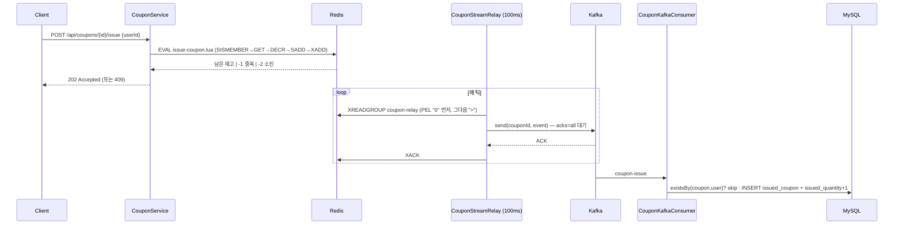

# Phase 4 — Redis Stream outbox: 예약과 발행 사이의 틈 메우기

Phase 3는 `SADD → DECR → Kafka 발행`이 세 번의 별도 호출이라 **차감 뒤 발행 전에 죽으면 재고만 줄고 발급은 안 되는 예약**이 남았다.
이 모듈은 중복 확인·재고 차감·발급 이벤트 기록을 **Lua 스크립트 한 번**으로 끝내고, Kafka 발행은 그 이벤트 Stream을 읽는 relay가 맡는다.
실험 모듈(`4-coupon_experiments`)의 `REDIS_STREAM` 경로를 Phase 1~3과 같은 Spring 구조로 다시 구현한 것이다.



| 구간 | 장애 시 결과 |
| --- | --- |
| Lua 실행 전 | 아무것도 안 바뀜 — 클라이언트 재시도 |
| Lua 실행 후 ~ Kafka 발행 전 | 재고·발급자·이벤트가 **함께** 남음 → relay가 Stream에서 이어서 발행 |
| Kafka 발행 후 ~ XACK 전 | 이벤트가 PEL에 남음 → 재시작한 relay가 같은 consumer 이름으로 PEL부터 재발행 → Consumer가 중복 건너뜀 |
| Kafka 중단 | API는 계속 202 접수, 이벤트는 Redis에 쌓임 → Kafka 복구 후 자동 흘러감 |

## Redis 키

쿠폰 ID를 해시 태그 `{}`로 감싸 Redis Cluster에서도 한 쿠폰의 키가 같은 슬롯에 놓인다 (Lua가 세 키를 함께 다루는 전제).

| 키 | 타입 | 역할 |
| --- | --- | --- |
| `coupon:{id}:stock` | string | 재고 카운터 |
| `coupon:{id}:users` | set | 발급자 집합 (중복 방지) |
| `coupon:{id}:events` | stream | 발급 이벤트, consumer group `coupon-relay` |
| `coupon:{id}:startDate` / `endDate` | string | 발급 기간 |
| `coupon:streams` | set | relay가 순회할 쿠폰 ID 목록 (`stock/init` 때 등록) |

## 실행

```bash
docker compose up -d                       # MySQL 3306 · Redis 6379 · Kafka 9092 (+ Grafana 3001)
cd spring && ./gradlew bootRun             # 또는 docker compose up -d --build spring
./reset-coupon.sh 1 100                    # DB 쿠폰 생성 + Redis 재고·Stream 초기화
./run-k6.sh 1 1000                         # 1,000명 동시 요청
./report.sh 1                              # Redis users == Stream == DB rows == issued_qty 대조
cd spring && ./gradlew test                # 동시 1,000명 · 동일 사용자 100회 · PEL 복구 (인프라 필요)
```

호스트 6379를 다른 컨테이너가 쓰고 있으면 override로 포트만 바꾼다:

```bash
printf 'services:\n  redis:\n    ports: !override\n      - "6380:6379"\n' > /tmp/redis-port.yml
docker compose -f docker-compose.yml -f /tmp/redis-port.yml up -d mysql redis kafka
SPRING_DATA_REDIS_PORT=6380 ./gradlew bootRun     # 테스트도 같은 환경변수로
```

## 측정 — 2026-10-25

k6 1,000 VU `shared-iterations`, 재고 100, Apple Silicon 1대에 앱·인프라 동거. 절대 성능이 아니라 동작 확인용.

| 항목 | 값 |
| --- | ---: |
| 처리량 | 3,766 req/s |
| 응답 p95 / 평균 | 206.76 ms / 156.96 ms |
| 발급 성공 / 정상 탈락 / 초과 발급 | 100 / 900 / 0 |
| Redis users = Stream XLEN = DB rows = issued_quantity | 100 = 100 = 100 = 100 |
| XPENDING | 0 |

Phase 3 수치(2026-09-12)와는 측정일·설정이 달라 직접 비교하지 않는다. 응답 시간은 접수(202)까지이며 DB 확정까지의 지연이 아니다.

**Kafka 중단 실험** — `docker stop kafka` 후 재고 5 쿠폰에 요청 3건: 모두 202, Redis `users=3 · XLEN=3 · XPENDING=1`(나머지 2건은 미전달 lag), DB 0건.
`docker start kafka` 2.3초 뒤 DB 3건·XPENDING 0·중복 0. relay 실패 로그 0건 — 블로킹 중이던 발행이 복구 직후 ACK를 받았다.

## Phase 3와 달라진 코드

| 파일 | 변경 |
| --- | --- |
| `resources/scripts/issue-coupon.lua` | 신규 — 중복 확인·차감·XADD 원자 실행 |
| `config/RedisConfig.java` | 신규 — Lua를 `RedisScript<Long>` 빈으로 로드 |
| `service/CouponRedisService.java` | `checkAndIssue`/`rollback` 제거 → `reserve`(Lua) · Stream group 생성 · `readEvents`(PEL 우선) · `acknowledge` |
| `service/CouponStreamRelay.java` | 신규 — `@Scheduled` 100ms, Stream → Kafka ACK → XACK |
| `service/CouponKafkaProducer.java` | `acks=all` 브로커 ACK를 기다린 뒤 반환 |
| `service/CouponService.issueCoupon` | Kafka 직접 발행 제거 — 기간 검증 + `reserve`만 |
| `domain/issuedcoupon/IssuedCoupon.java` | `(coupon_id, user_id)` 유니크 제약 — DB 차원 최종 중복 방어선 |

적용한 컨벤션: 소문자 패키지(`issuedcoupon`), `Status` 중복 enum → `CouponStatus`/`IssuedCouponStatus`, 엔티티 setter 제거(`@NoArgsConstructor(PROTECTED)` + `@Builder` + `issue()`/`use()` 도메인 메서드), 요청·응답 record DTO, `Object` 반환 → 타입 명시, `GlobalExceptionHandler`, 인프라 어댑터는 `@Component`.

## 남은 한계

- **relay 하나 전제** — consumer 이름 고정. 인스턴스를 늘리면 인스턴스별 이름 + `XAUTOCLAIM`으로 죽은 consumer의 PEL을 넘겨받아야 한다.
- **Redis 내구성** — AOF `everysec`라 최대 1초 유실 가능. 복제 지연 중 failover면 승인된 예약·이벤트가 사라질 수 있다(실험 모듈에서 재현한 바와 같다). Lua는 Redis 안에서만 원자적이고 Kafka·DB까지 묶지 않는다.
- **at-least-once** — XACK 전 재시작·발행 타임아웃이면 같은 이벤트가 Kafka에 두 번 갈 수 있다. Consumer의 발급 여부 검사와 DB 유니크 제약이 흡수한다.
- **Stream 정리 없음** — `XTRIM`/`MAXLEN` 미적용. 운영이라면 보존 정책이 필요하다.
- **폴링 100ms** — `StreamMessageListenerContainer`로 바꾸면 블로킹 읽기가 되지만, 쿠폰별 Stream 구독 등록·PEL 복구를 따로 다뤄야 해서 이 단계에서는 `@Scheduled`로 뒀다.
