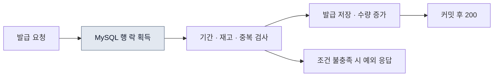
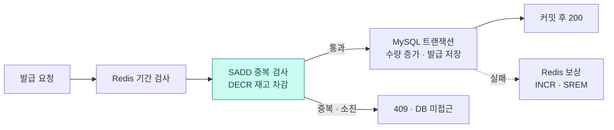
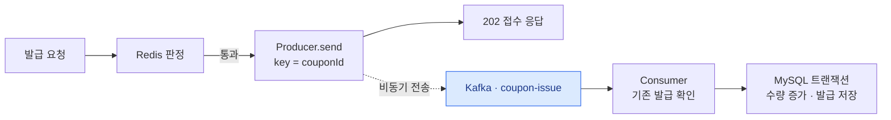

<div align="center">

# Coupon Rush

**100개 쿠폰에 몰리는 요청, 세 가지 동시성 제어 방식으로 비교했습니다.**


[성능 비교](#성능-비교) · [아키텍처](#아키텍처) · [설계와 코드](#설계와-코드) · [직접 실행하기](#직접-실행하기) · [검증 범위](#검증-범위) · [남은 과제](#남은-과제)

</div>

---

선착순 발급의 핵심은 **정해진 수량을 넘기지 않고, 같은 사용자에게 한 번만 발급하는 것**입니다. 이 요구사항을 DB 비관적 락, Redis, Redis + Kafka로 각각 구현했습니다. 발급 판정 위치와 DB 저장 시점을 바꾸면서 HTTP 응답과 최종 발급 수량을 함께 확인했습니다.

SW마에스트로 멘토링 [과제 명세](ASSIGNMENT.md)에서 시작한 개인 프로젝트입니다. 2026.05에 구현을 시작하고, 2026.09에 테스트 보완·부하 비교·문서화를 진행했습니다.

| 단계 | 발급 판정 | DB 저장 | 성공 응답의 의미 |
| --- | --- | --- | --- |
| **01 · DB Lock** | MySQL 행 락 안에서 재고·중복 검사 | 요청 트랜잭션에서 저장 | `200` · DB 저장 완료 |
| **02 · Redis** | Redis `SADD` → `DECR` | 판정 통과 건만 동기 저장 | `200` · DB 저장 완료 |
| **03 · Redis + Kafka** | Phase 2와 동일 | Consumer가 비동기 저장 | `202` · 요청 접수 |

## 성능 비교

**k6 1,000 VU / 총 1,000 iterations / 재고 100개**, 2026-09-12 측정 기록입니다.


| 지표 | DB Lock | Redis | Redis + Kafka |
| --- | ---: | ---: | ---: |
| HTTP 응답 **p95** | 967.75 ms | 303.08 ms | **158.57 ms** |
| HTTP 요청 처리량 | 937.13 req/s | 2,329.36 req/s | **3,892.79 req/s** |
| HTTP 응답 평균 | 753.10 ms | 122.65 ms | 102.18 ms |
| 성공·접수 응답 / 나머지 응답 | 100 / 900 | 100 / 900 | 100 / 900 |
| 최종 DB 발급 수 / 초과 발급 | 100 / 0 | 100 / 0 | 100 / 0 |

> **이 수치가 뜻하는 것**
>
> 앱과 인프라를 한 대의 Apple Silicon MacBook에서 실행한 비교입니다. p95와 처리량은 성공·접수·탈락을 합친 **전체 HTTP 요청** 기준입니다. Phase 3의 `202`는 Kafka 전송 완료와 DB 저장 완료를 기다리지 않으므로, 이 표를 **최종 발급 완료가 6.1배 빨라졌다는 뜻으로 해석하지 않습니다.**
>
> 운영 처리량, 장시간 부하, 반복 측정의 분산, 접수부터 DB 저장까지의 지연은 이 기록에 포함되지 않습니다.

평균·중앙값·p90·최대값과 측정 조건은 [벤치마크 기록](docs/benchmark-2026-09-12.md)에 있습니다.

## 아키텍처

Phase 3의 구성입니다. Controller·Service·Producer·Consumer는 **하나의 Spring Boot 앱 안**에 있습니다. Redis는 발급 가능 여부를 판정하고, Kafka는 판정을 통과한 건을 전달하며, MySQL은 최종 발급 기록을 저장합니다.


실선은 호출·조회·소비, 점선은 Producer의 비동기 전송입니다. **접수 응답과 Consumer 저장 완료의 순서는 고정되지 않습니다.** HTTP 응답은 Kafka 전송 Future를 기다리지 않습니다. [SVG 원본](docs/assets/phase-3-architecture.svg) · [Mermaid 구조 명세](docs/architecture/phase-3.mmd)

## 설계와 코드

### 01 · DB 락으로 기준선 만들기



`SELECT … FOR UPDATE`로 쿠폰 행을 잠그고 판정과 저장을 한 트랜잭션에 묶었습니다. 같은 쿠폰을 요청하면 해당 행 락을 기다려야 합니다. 이후 두 단계에서 바꿀 기준선입니다.

[발급 서비스](1-coupon_db_lock/spring/src/main/java/com/example/coupon/service/CouponService.java) · [비관적 락 조회](1-coupon_db_lock/spring/src/main/java/com/example/coupon/repository/CouponRepository.java)

### 02 · Redis에서 탈락 요청 걸러내기



- **중복 검사부터 수행합니다.** `SADD`가 새 사용자를 추가한 경우에만 `DECR`로 재고를 차감합니다. 차감 결과가 음수면 `INCR`와 `SREM`으로 되돌립니다.
- **DB 트랜잭션 범위를 줄였습니다.** 판정을 통과한 건만 `TransactionTemplate`에서 발급 기록을 저장합니다. 중복·소진 요청은 DB 조회 없이 끝납니다.
- **저장 실패를 보상합니다.** DB 트랜잭션에서 예외가 나면 Redis의 재고와 사용자 집합을 되돌립니다. 보상 자체가 실패하는 경우까지 복구하는 구조는 아직 없습니다.

`SADD`와 `DECR`는 **각 명령이 원자적**입니다. 여러 명령과 DB 저장 전체를 하나의 원자적 연산으로 묶은 것은 아닙니다.

[Redis 판정·보상](2-coupon_redis/spring/src/main/java/com/example/coupon/service/CouponRedisService.java) · [DB 트랜잭션 경계](2-coupon_redis/spring/src/main/java/com/example/coupon/service/CouponService.java)

### 03 · Kafka로 접수와 저장 분리하기



Phase 2의 Redis 판정을 유지하고, 판정 이후 DB 쓰기를 Consumer로 옮겼습니다.

| 결정 | 구현 | 범위 |
| --- | --- | --- |
| 쿠폰별 이벤트를 같은 파티션으로 | 메시지 키에 `couponId` 사용 | 파티션에 기록된 순서 기준. HTTP 요청 도착 순서 전체를 보장하지 않음 |
| 이미 저장한 발급 건 건너뛰기 | `(couponId, userId)` 존재 조회 | DB 커밋 후 SIGKILL·같은 offset 재전달 3회 검증. DB 유일 제약은 추가 과제 |
| Kafka 자동 오프셋 커밋 끄기 | `enable-auto-commit: false`, `ack-mode: batch` | Spring 리스너 컨테이너가 poll 단위 커밋 관리. 직접 수동 ACK를 호출하지 않음 |
| 토픽·소비 병렬도 명시 | `NewTopic`, 파티션 수·listener concurrency 설정 | P1/C1·P3/C1·P3/C3 비교. 같은 키의 이벤트는 한 파티션에 집중 |
| 접수 응답 먼저 반환하기 | `KafkaTemplate.send()`의 Future를 기다리지 않음 | `202` 응답 시점에 브로커 전송 성공·DB 저장을 보장하지 않음 |

[발급 서비스](3-coupon_redis_kafka/spring/src/main/java/com/example/coupon/service/CouponService.java) · [Producer](3-coupon_redis_kafka/spring/src/main/java/com/example/coupon/service/CouponKafkaProducer.java) · [Consumer](3-coupon_redis_kafka/spring/src/main/java/com/example/coupon/service/CouponKafkaConsumer.java) · [Kafka 설정](3-coupon_redis_kafka/spring/src/main/resources/application.yml)

## 직접 실행하기

필요한 도구는 **JDK 17, Docker Compose, k6**입니다. 세 단계는 컨테이너 이름과 호스트 포트를 공유하므로 한 번에 하나씩 실행합니다.

### 1. 인프라와 앱 실행

아래는 **Phase 3을 로컬 JVM에서 실행**하는 예입니다. Compose에서는 인프라 서비스만 지정해 앱의 `8080` 포트가 겹치지 않게 합니다.

```bash
git clone https://github.com/joejaeyoung/Project-coupon_rush.git
cd Project-coupon_rush/3-coupon_redis_kafka
docker compose up -d mysql redis kafka
docker compose ps
```

MySQL·Redis·Kafka가 기동된 뒤 같은 터미널에서 앱을 실행합니다.

```bash
cd spring
./gradlew bootRun
```

다른 단계를 실행할 때는 해당 폴더에서 아래 서비스만 올립니다. 앱 실행 명령은 같습니다.

| 폴더 | 인프라 실행 명령 |
| --- | --- |
| `1-coupon_db_lock` | `docker compose up -d mysql` |
| `2-coupon_redis` | `docker compose up -d mysql redis` |
| `3-coupon_redis_kafka` | `docker compose up -d mysql redis kafka` |

### 2. 쿠폰 초기화 → 요청 → 결과 대조

새 터미널에서 선택한 Phase 폴더로 이동합니다. 앱 기동과 테이블 생성이 완료된 뒤 실행합니다.

```bash
cd Project-coupon_rush/3-coupon_redis_kafka
curl --fail http://localhost:8080/actuator/health
./reset-coupon.sh 1 100
k6 run -e COUPON_ID=1 -e USERS=1000 k6/concurrent-issue.js
./report.sh 1
```

`reset-coupon.sh`는 지정한 쿠폰의 발급 기록과 수량을 초기화하는 로컬 실험용 스크립트입니다. Phase 3은 Consumer 처리가 끝난 뒤 `report.sh`를 다시 확인하고, 이전 실험의 이벤트가 남아 있는 동안 다음 실험을 시작하지 않습니다.

<details>
<summary><strong>API 한 건을 직접 호출하려면</strong></summary>

부하 테스트로 재고를 소진했다면 먼저 쿠폰을 다시 초기화합니다.

```bash
curl -i -X POST http://localhost:8080/api/coupons/1/issue \
  -H 'Content-Type: application/json' \
  -d '{"userId":42}'

curl http://localhost:8080/api/coupons/users/42
```

Phase 1·2는 저장 후 `200`, Phase 3은 접수 후 `202`를 반환합니다. Phase 3의 보유 쿠폰 조회는 Consumer 저장 전이면 비어 있을 수 있습니다.

</details>

<details>
<summary><strong>모니터링과 종료</strong></summary>

기본 Prometheus 대상은 컨테이너 앱 `spring:8080`입니다. 위의 로컬 JVM 실행 방식을 사용한다면, Docker Desktop에서는 `prometheus/prometheus.yml`의 대상을 `host.docker.internal:8080`으로 바꾼 뒤 서비스를 시작합니다. 컨테이너 앱을 실행할 때는 원래 대상을 유지합니다.

선택한 Phase 폴더에서 모니터링 서비스를 추가합니다.

```bash
docker compose up -d influxdb prometheus grafana
./run-k6.sh 1 1000
```

앱 `8080` · MySQL `3306` · Redis `6379` · Kafka `9092` · Prometheus `9090` · InfluxDB `8086` · **Grafana `3001`**. 연결 설정은 [모니터링 기록](docs/monitoring.md)을 참고합니다. MySQL `coupon` / `coupon`, Grafana `admin` / `admin`은 로컬 실험용 기본값입니다.

다른 단계로 옮기기 전에는 `bootRun`을 `Ctrl+C`로 종료하고, 실행했던 Phase 폴더에서 `docker compose down`으로 컨테이너를 내립니다. 데이터 볼륨은 남습니다.

</details>

## 검증 범위

정확성 테스트와 HTTP 부하 측정을 나누었습니다.

| 검증 | 시나리오 | 확인하는 값 |
| --- | --- | --- |
| JUnit 동시성 | 서로 다른 사용자 1,000명의 작업을 **32개 스레드 풀**에서 실행 | 성공 100 · 성공+탈락 1,000 · DB 발급 100 |
| JUnit 중복 요청 | 같은 사용자로 100회 요청, 32개 스레드 풀 | 성공 1 · DB 발급 1 |
| k6 HTTP 부하 | `shared-iterations`, 1,000 VU / 1,000 iterations | 응답 지연 · 전체 요청 처리량 · 상태별 응답 카운터 |
| 사후 대조 | Phase 1은 MySQL, Phase 2·3은 Redis와 MySQL | DB 행 수·발급 수량, Redis 재고·사용자 수 |

JUnit은 `CountDownLatch`로 작업 시작을 맞추고, Phase 3은 Awaitility로 최대 30초 동안 DB 저장 결과를 기다립니다. **1,000개 스레드를 한꺼번에 실행하는 테스트는 아닙니다.**

인프라가 실행된 상태에서, 선택한 Phase의 `spring/` 폴더에서 실행합니다. 앱의 `bootRun`은 종료해 테스트용 Spring 컨텍스트만 동작하게 합니다. 테스트는 기존 발급 데이터를 삭제하므로 별도 실험 데이터로 실행합니다.

```bash
./gradlew test --tests '*CouponConcurrencyTest*'
```

[Phase 1 테스트](1-coupon_db_lock/spring/src/test/java/com/example/coupon/CouponConcurrencyTest.java) · [Phase 2 테스트](2-coupon_redis/spring/src/test/java/com/example/coupon/CouponConcurrencyTest.java) · [Phase 3 테스트](3-coupon_redis_kafka/spring/src/test/java/com/example/coupon/CouponConcurrencyTest.java)

**k6 결과를 읽을 때:** 재고 소진·중복의 `409`도 `http_req_failed`에 포함됩니다. `coupon_issue_fail` 역시 모든 비성공 응답을 세므로, 이 카운터만으로 모든 탈락이 정상 `409`라고 판정하지 않습니다. 현재 `p95 < 300ms` 임계값은 기록상 Phase 1·2가 넘었습니다. 또 `shared-iterations`는 VU별 정확히 한 번의 실행을 보장하지 않아, 1,000 iterations를 서로 다른 사용자 1,000명으로 단정하지 않습니다.

## Kafka 확장·복구 실험 · 2026-09-13

단일 호스트에서 **6,000건 전량 유효 요청·HTTP 작업자 64개**로 키 분포와 파티션·Consumer 수를 비교했습니다. 구성별 3회, 총 18회·108,000건에서 DB·Redis 수량 불일치와 중복 그룹은 0이었습니다. 아래 지연은 요청 시작부터 DB 커밋 후 관측까지의 p95이며, 세 번의 중앙값입니다.

- **쿠폰 30개 분산:** P1/C1 → P3/C3에서 **29.30초 → 14.10초, 51.9% 감소**. 세 Consumer의 파티션별 처리 기록을 확인했습니다.
- **쿠폰 1개 집중:** **28.65초 → 29.45초**. Consumer를 늘려도 6,000건이 한 파티션·한 스레드에서 처리됐습니다.
- **SIGKILL·재시작 3회:** DB 2건·커밋 오프셋 1에서 강제 종료하고 같은 offset 1의 재전달을 확인했습니다. 재처리 후 DB 발급 행 51·발급 수량 51·중복 그룹 0·Lag 0이었습니다.

[전체 결과·그래프·원본 데이터](docs/experiments/kafka-2026-09-13/README.md) · [재현 방법과 실험 코드](experiments/kafka/README.md)

## API

| Method | Endpoint | 동작 |
| --- | --- | --- |
| `GET` | `/api/coupons/available` | `ACTIVE` 상태 쿠폰 목록 |
| `POST` | `/api/coupons/{couponId}/issue` | 선착순 발급 요청 · JSON `{"userId":42}` |
| `GET` | `/api/coupons/{couponId}/stock` | 잔여 수량 |
| `POST` | `/api/coupons/{couponId}/stock/init` | Redis 초기화 · Phase 2·3의 실험 준비용 |
| `GET` | `/api/coupons/users/{userId}` | 보유 쿠폰 |
| `GET` | `/api/coupons/users/{userId}/usable` | `ISSUED` 상태 쿠폰 목록 |
| `POST` | `/api/coupons/{issuedCouponId}/use` | 상태·만료일 검사 후 사용 처리 |

발급 시 재고 소진·중복은 `409`, 기간 외는 `400`, 쿠폰 없음은 `404`입니다. 응답은 `success`, `data`, `message` 공통 형식입니다.

## 남은 과제

정상 수량·중복 제어, 파티션·Consumer 비교, DB 커밋 후 재시작·재전달을 검증했습니다. 다음 경계는 추가 구현·검증이 필요합니다.

| 경계 | 현재 상태 | 다음에 확인할 것 |
| --- | --- | --- |
| Redis 판정 도중 중단 | 여러 명령을 순서대로 실행 | Lua 등으로 판정을 묶고 명령 사이 실패 주입 |
| Redis 차감 → Kafka 발행 | 전송 결과 처리·실패 보상 없음 | 발행 성공 확인, 재시도·대사, 영속적인 이벤트 전달 설계 |
| Consumer 재처리 | 같은 그룹의 SIGKILL·재전달 3회 통과, DB 유일 제약 없음 | 유일 제약, 독립 그룹의 동시 중복, 명시적인 재시도·DLQ 정책 |
| Redis 장애 | 단일 노드, **AOF `everysec` 설정 있음** | 복구 시 데이터 손실·DB 대사, 이중화 |
| 성능 비교 | 혼합 HTTP 비교와 전량 유효 요청→DB 지연 18회 측정 | 지속 부하·자원 격리, 실패 이벤트, 접수량 제한과 적체 관리 |
| 취소·철회 | 발급 재고를 되돌리는 업무 흐름 없음 | 취소 상태 전이와 재고 보정 |

특히 **`202` 접수 이후에도 Kafka 전송 실패로 발급이 저장되지 않을 수 있습니다.** Redis 재고 차감과 이벤트 전달을 함께 복구하는 설계까지 구현한 시스템은 아닙니다.

## 더 읽기

| 문서 | 내용 |
| --- | --- |
| [측정 기록](docs/benchmark-2026-09-12.md) | 원래 수치 · 측정 조건 · 해석 범위 |
| [Kafka 실증](docs/experiments/kafka-2026-09-13/README.md) | 18회 확장 비교 · SIGKILL 복구 3회 · 요청·완료·Lag 원본 |
| [Kafka 실험 실행](experiments/kafka/README.md) | 전용 인프라 · 실험용 JAR · 실행기 · 원본 대조 |
| [DB 락](docs/phase1-study.md) / [Redis](docs/phase2-study.md) / [Kafka](docs/phase3-study.md) | 단계별 학습·구현 기록 |
| [Redis 학습](docs/redis_study.md) / [Kafka 학습](docs/kafka_study.md) | 사용한 기술의 학습 메모 |
| [모니터링](docs/monitoring.md) | Prometheus · Grafana · k6 연결 기록 |
| [브라우저 테스트 페이지](load-test.html) | 로컬 API를 직접 호출하는 화면 |
| [과제 명세](ASSIGNMENT.md) | 프로젝트의 출발점과 요구사항 |

각 Phase 폴더는 `spring/`, `docker-compose.yml`, `k6/`, `reset-coupon.sh`, `report.sh`를 포함합니다. `docs/`의 학습 기록에는 당시 계획과 구현 메모가 섞여 있으며, 현재 구현 범위는 이 README와 연결된 소스를 기준으로 확인할 수 있습니다.
