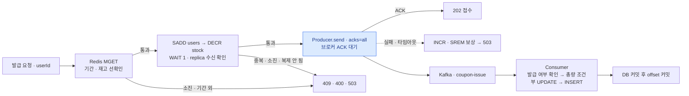
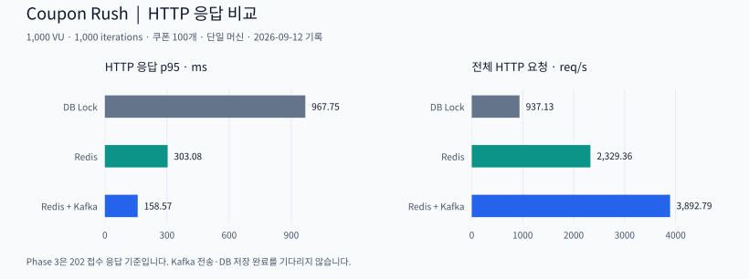
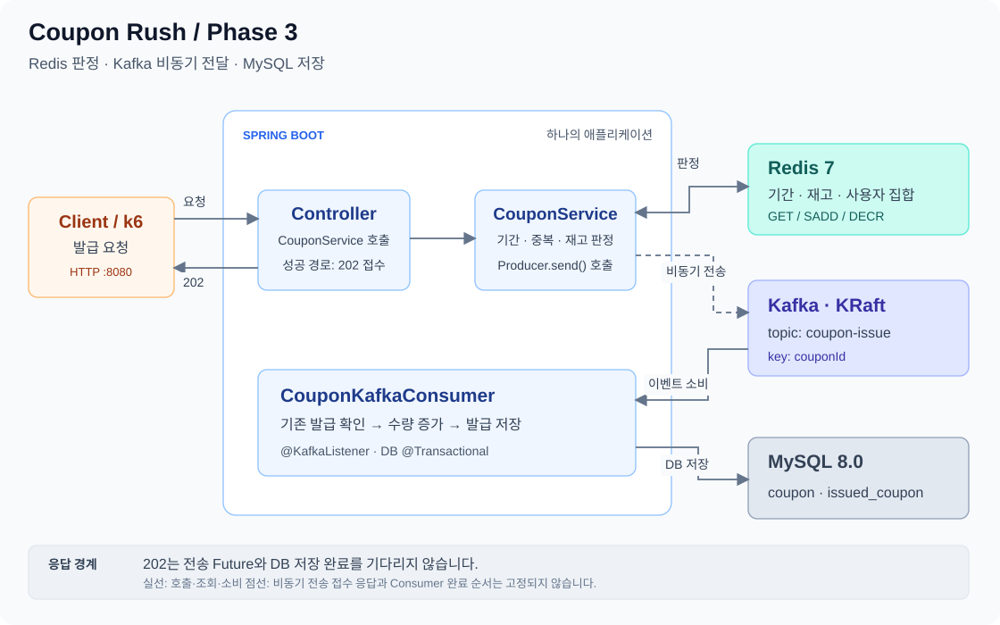
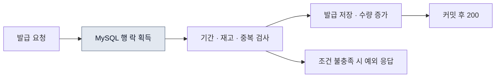
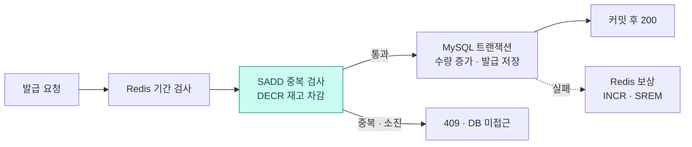
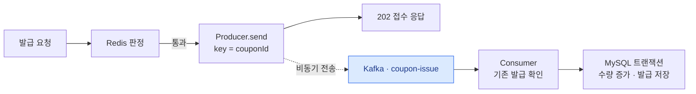

<div align="center">

# Coupon Rush

**선착순 쿠폰 발급을 DB 락 → Redis → Redis+Kafka → Kafka ACK 확인·보상의 네 단계로 구현하고, 같은 부하로 비교했습니다.**


[최신 구현](#최신-구현) · [측정 결과](#측정-결과) · [실행](#실행) · [기존 세 단계](#기존-phase-13) · [남은 과제](#남은-과제)

</div>

DB 비관적 락 → Redis → Redis+Kafka의 세 단계 비교에서 시작한 개인 프로젝트입니다. 2026년 10월에 다섯 경로(Redis 앞단·Kafka 앞단·DB Outbox·Redis Streams)를 독립 실험 모듈로 구현해 장애·순서·분포를 관찰했고([실증 보고서](docs/experiments-2026-10-22.md)), 그 결과를 들고 간 멘토링(2026-10-25)에서 "KV outbox는 복잡해진다, 어차피 있는 Kafka를 써라"는 피드백을 받았습니다. 그래서 4단계는 실험 모듈이 아니라 **Phase 3에 브로커 ACK 확인과 보상만 더한 최소 구성**으로 정리했습니다.

**현재 구현 기준은 `4-coupon_redisHA_kafka/`입니다.** 기존 `1-coupon_db_lock/`·`2-coupon_redis/`·`3-coupon_redis_kafka/`는 비교 기준선으로 보존합니다. 실험 모듈 `4-coupon_experiments/`는 main에서 제거했고, 코드·결과 파일은 커밋 [`dc0e901`](https://github.com/joejaeyoung/Project-coupon_rush/tree/dc0e901/4-coupon_experiments)에 남아 있습니다.

## 최신 구현

Phase 3와 같은 흐름(Redis 판정 → Kafka → Consumer가 DB 저장)이지만, **"Kafka에 갔는지"를 응답 전에 확정**합니다. 브로커 ACK(`acks=all`)를 받으면 202, 못 받으면 Redis 예약을 되돌리고 503입니다. Redis는 primary·replica·Sentinel 3으로 구성했고, 예약은 replica가 받은 뒤(`WAIT`)에만 승인합니다.



| Phase 3와 다른 점 | 구현 | 코드 |
| --- | --- | --- |
| 브로커 ACK 확인 | `send().join()`. 포기 시점은 `delivery.timeout.ms`(10 s) 등 producer 설정만 소유 | [Producer](4-coupon_redisHA_kafka/spring/src/main/java/com/example/coupon/service/CouponKafkaProducer.java) · [설정](4-coupon_redisHA_kafka/spring/src/main/resources/application.yml) |
| 발행 실패 보상 | `INCR`·`SREM`으로 예약을 되돌리고 `503 ISSUE_FAILED`, WARN 로그 | [CouponService](4-coupon_redisHA_kafka/spring/src/main/java/com/example/coupon/service/CouponService.java) |
| 소진 뒤 요청은 1 RTT | `MGET`으로 기간·재고 선확인. 소진 뒤 요청은 SADD·DECR·보상 없이 409 | [CouponRedisService](4-coupon_redisHA_kafka/spring/src/main/java/com/example/coupon/service/CouponRedisService.java) |
| DB 최종 방어 | `(coupon_id, user_id)` 유니크 제약 + `issued_quantity < total_quantity` 조건부 UPDATE가 게이트 | [IssuedCoupon](4-coupon_redisHA_kafka/spring/src/main/java/com/example/coupon/domain/IssuedCoupon.java) · [Consumer](4-coupon_redisHA_kafka/spring/src/main/java/com/example/coupon/service/CouponKafkaConsumer.java) |
| Redis HA | primary·replica·Sentinel 3. Lettuce가 Sentinel에게 primary를 묻고 failover 뒤 자동으로 옮겨 붙습니다. 다시 승인되기까지 WAIT 켜면 10.5 s, 끄면 4.9 s | [compose](4-coupon_redisHA_kafka/docker-compose.yml) · [failover.sh](4-coupon_redisHA_kafka/failover.sh) |
| 뼈대만 | API는 발급·재고 조회·재고 초기화 셋. 할인·사용·목록 기능과 모니터링 스택은 뺐습니다 | [모듈 README](4-coupon_redisHA_kafka/README.md) |

| 멘토링 피드백 (2026-10-25) | 반영 |
| --- | --- |
| Redis Stream(KV) outbox는 복잡해진다. 어차피 Kafka가 있으니 있는 걸 써라 | Stream·relay·Lua 제거. API가 Kafka에 직접 발행하고 ACK를 확인 |
| 비동기로 돌리면 남는 게 없다. 로그로 남겨라 | 발행 실패·DB 총량 거부·중복 건너뜀을 WARN/INFO 로그로 |
| Redis primary↔replica는 세 포인트만 (비동기 유실 · 스냅샷 복구 · 복제 대기) | primary·replica·Sentinel 3 구성, 예약 직후 `WAIT`로 replica 수신 확인, 양쪽 AOF. failover·복제 지연 실험으로 WAIT 유무의 차이를 확인했습니다 |

Lua를 뺀 이유와 `MULTI/EXEC`로는 판정을 묶지 못하는 이유는 [모듈 README](4-coupon_redisHA_kafka/README.md#lua-스크립트의-단점-멘토-질문)에 있습니다.

## 측정 결과

k6 1,000 VU `per-vu-iterations`(VU당 1회, 서로 다른 사용자 1,000명), 재고 100, 2026-10-26, Apple Silicon 1대에 앱·인프라 동거. 동작 확인용이며 9월 수치와 직접 비교하지 않습니다. 성공 응답에는 Kafka ACK 대기가 포함됩니다.

| 지표 | Phase 4 |
| --- | ---: |
| HTTP 응답 p95 / 평균 | 177.73 / 54.06 ms |
| HTTP 요청 처리량 | 2,394 req/s |
| 접수 / 탈락 / 초과 발급 | 100 / 900 / 0 |
| Redis 명령 수 (요청 1,000건) | 1,600 — MGET 1,000 · SADD/DECR 400 · INCR/SREM 200 |
| Redis users = DB rows = issued_quantity | 100 = 100 = 100 |

**Kafka 중단 실험** — `docker stop kafka` 후 재고 5 쿠폰에 요청 1건: 10.0초 뒤 503, Redis `stock=5 · users=0`으로 되돌아갔습니다. Phase 3라면 재고만 줄고 사용자는 "이미 발급"으로 남았을 상황입니다.

**Redis failover 실험** (`failover.sh`) — primary를 kill한 뒤 다시 202가 나오기까지 WAIT를 켜면 10.5초(옛 primary가 replica로 돌아와야 통과), 끄면 4.9초. 복제 지연 중에는 WAIT가 승인 자체를 거절해 소실 0, 끄면 승인된 5건이 사라지고 5명이 202만 받고 쿠폰을 못 받았습니다. 건강한 replica에서 WAIT 비용은 호출당 19 µs였습니다. 상세는 [모듈 README](4-coupon_redisHA_kafka/README.md#redis-ha--2026-10-26).

JUnit 4건(동시 1,000명 → 100 · 동일 사용자 100회 → 1 · 발행 실패 보상 · 잘못된 본문 400)은 실제 MySQL·Redis·Kafka를 띄우고 실행합니다.

## 실행

JDK 17, Docker Compose, k6가 필요합니다. 네 단계는 컨테이너 이름과 호스트 포트를 공유하므로 한 번에 하나만 실행합니다.

```bash
git clone https://github.com/joejaeyoung/Project-coupon_rush.git
cd Project-coupon_rush/4-coupon_redisHA_kafka
docker compose up -d --wait              # MySQL 3306 · Redis 6381/6382 + Sentinel 26379~26381 · Kafka 9092
(cd spring && ./gradlew bootRun)
./reset-coupon.sh 1 100                  # DB 쿠폰 생성 + Redis 재고 초기화
k6 run -e COUPON_ID=1 -e USERS=1000 k6/concurrent-issue.js
./report.sh 1                            # Redis users == DB rows == issued_qty 대조
./failover.sh                            # primary kill → 다시 승인까지 (lag: 복제 지연 중 승인 소실)
(cd spring && ./gradlew test)            # bootRun을 끈 뒤
```

Redis는 6381/6382를 쓰므로 6379를 점유한 다른 컨테이너와 겹치지 않습니다.

## 기존 Phase 1~3

2026년 5~9월에 구현한 세 기준선입니다. Phase 4는 Phase 3 코드를 바탕으로 만들었고, 세 기준선의 코드는 바꾸지 않았습니다.

| 단계 | 판정·저장 | 성공 응답 |
| --- | --- | --- |
| `1-coupon_db_lock` | MySQL 행 락 안에서 판정·저장 | DB 저장 후 200 |
| `2-coupon_redis` | SADD·DECR 개별 판정 후 DB 저장 | DB 저장 후 200 |
| `3-coupon_redis_kafka` | Redis 판정 후 Kafka Consumer가 DB 저장 | 전송 Future·DB 완료를 기다리지 않는 202 |

<details>
<summary><strong>기존 성능 비교·아키텍처·실행 방법·API 보기</strong></summary>

## 성능 비교

**k6 1,000 VU / 총 1,000 iterations / 재고 100개**, 2026-09-12 측정 기록입니다.



| 지표 | DB Lock | Redis | Redis + Kafka |
| --- | ---: | ---: | ---: |
| HTTP 응답 **p95** | 967.75 ms | 303.08 ms | **158.57 ms** |
| HTTP 요청 처리량 | 937.13 req/s | 2,329.36 req/s | **3,892.79 req/s** |
| HTTP 응답 평균 | 753.10 ms | 122.65 ms | 102.18 ms |
| 성공·접수 응답 / 나머지 응답 | 100 / 900 | 100 / 900 | 100 / 900 |
| 최종 DB 발급 수 / 초과 발급 | 100 / 0 | 100 / 0 | 100 / 0 |

> **이 수치가 뜻하는 것**
>
> 앱과 인프라를 한 대의 Apple Silicon MacBook에서 실행한 비교입니다. p95와 처리량은 성공·접수·탈락을 합친 **전체 HTTP 요청** 기준입니다. Phase 3의 `202`는 Kafka 전송 완료와 DB 저장 완료를 기다리지 않으므로, 이 표를 **최종 발급 완료가 6.1배 빨라졌다는 뜻으로 해석하지 않습니다.**
>
> 운영 처리량, 장시간 부하, 반복 측정의 분산, 접수부터 DB 저장까지의 지연은 이 기록에 포함되지 않습니다.

평균·중앙값·p90·최대값과 측정 조건은 [벤치마크 기록](docs/benchmark-2026-09-12.md)에 있습니다.

## 아키텍처

Phase 3의 구성입니다. Controller·Service·Producer·Consumer는 **하나의 Spring Boot 앱 안**에 있습니다. Redis는 발급 가능 여부를 판정하고, Kafka는 판정을 통과한 건을 전달하며, MySQL은 최종 발급 기록을 저장합니다.



실선은 호출·조회·소비, 점선은 Producer의 비동기 전송입니다. **접수 응답과 Consumer 저장 완료의 순서는 고정되지 않습니다.** HTTP 응답은 Kafka 전송 Future를 기다리지 않습니다. [SVG 원본](docs/assets/phase-3-architecture.svg) · [Mermaid 구조 명세](docs/architecture/phase-3.mmd)

## 설계와 코드

### 01 · DB 락으로 기준선 만들기



`SELECT … FOR UPDATE`로 쿠폰 행을 잠그고 판정과 저장을 한 트랜잭션에 묶었습니다. 같은 쿠폰을 요청하면 해당 행 락을 기다려야 합니다. 이후 두 단계에서 바꿀 기준선입니다.

[발급 서비스](1-coupon_db_lock/spring/src/main/java/com/example/coupon/service/CouponService.java) · [비관적 락 조회](1-coupon_db_lock/spring/src/main/java/com/example/coupon/repository/CouponRepository.java)

### 02 · Redis에서 탈락 요청 걸러내기



- **중복 검사부터 수행합니다.** `SADD`가 새 사용자를 추가한 경우에만 `DECR`로 재고를 차감합니다. 차감 결과가 음수면 `INCR`와 `SREM`으로 되돌립니다.
- **DB 트랜잭션 범위를 줄였습니다.** 판정을 통과한 건만 `TransactionTemplate`에서 발급 기록을 저장합니다. 중복·소진 요청은 DB 조회 없이 끝납니다.
- **저장 실패를 보상합니다.** DB 트랜잭션에서 예외가 나면 Redis의 재고와 사용자 집합을 되돌립니다. 보상 자체가 실패하는 경우까지 복구하는 구조는 아직 없습니다.

`SADD`와 `DECR`는 **각 명령이 원자적**입니다. 여러 명령과 DB 저장 전체를 하나의 원자적 연산으로 묶은 것은 아닙니다.

[Redis 판정·보상](2-coupon_redis/spring/src/main/java/com/example/coupon/service/CouponRedisService.java) · [DB 트랜잭션 경계](2-coupon_redis/spring/src/main/java/com/example/coupon/service/CouponService.java)

### 03 · Kafka로 접수와 저장 분리하기



Phase 2의 Redis 판정을 유지하고, 판정 이후 DB 쓰기를 Consumer로 옮겼습니다.

| 결정 | 구현 | 범위 |
| --- | --- | --- |
| 쿠폰별 이벤트를 같은 파티션으로 | 메시지 키에 `couponId` 사용 | 파티션에 기록된 순서 기준. HTTP 요청 도착 순서 전체를 보장하지 않음 |
| 이미 저장한 발급 건 건너뛰기 | `(couponId, userId)` 존재 조회 | DB 유일 제약과 중복 이벤트 재전달 테스트는 추가 과제 |
| Kafka 자동 오프셋 커밋 끄기 | `enable-auto-commit: false` | Spring 리스너 컨테이너가 커밋 관리. 직접 `acknowledge()`하는 수동 ACK 구현은 없음 |
| 접수 응답 먼저 반환하기 | `KafkaTemplate.send()`의 Future를 기다리지 않음 | `202` 응답 시점에 브로커 전송 성공·DB 저장을 보장하지 않음 |

[발급 서비스](3-coupon_redis_kafka/spring/src/main/java/com/example/coupon/service/CouponService.java) · [Producer](3-coupon_redis_kafka/spring/src/main/java/com/example/coupon/service/CouponKafkaProducer.java) · [Consumer](3-coupon_redis_kafka/spring/src/main/java/com/example/coupon/service/CouponKafkaConsumer.java) · [Kafka 설정](3-coupon_redis_kafka/spring/src/main/resources/application.yml)

## 직접 실행하기

필요한 도구는 **JDK 17, Docker Compose, k6**입니다. 세 단계는 컨테이너 이름과 호스트 포트를 공유하므로 한 번에 하나씩 실행합니다.

### 1. 인프라와 앱 실행

아래는 **Phase 3을 로컬 JVM에서 실행**하는 예입니다. Compose에서는 인프라 서비스만 지정해 앱의 `8080` 포트가 겹치지 않게 합니다.

```bash
git clone https://github.com/joejaeyoung/Project-coupon_rush.git
cd Project-coupon_rush/3-coupon_redis_kafka
docker compose up -d mysql redis kafka
docker compose ps
```

MySQL·Redis·Kafka가 기동된 뒤 같은 터미널에서 앱을 실행합니다.

```bash
cd spring
./gradlew bootRun
```

다른 단계를 실행할 때는 해당 폴더에서 아래 서비스만 올립니다. 앱 실행 명령은 같습니다.

| 폴더 | 인프라 실행 명령 |
| --- | --- |
| `1-coupon_db_lock` | `docker compose up -d mysql` |
| `2-coupon_redis` | `docker compose up -d mysql redis` |
| `3-coupon_redis_kafka` | `docker compose up -d mysql redis kafka` |

### 2. 쿠폰 초기화 → 요청 → 결과 대조

새 터미널에서 선택한 Phase 폴더로 이동합니다. 앱 기동과 테이블 생성이 완료된 뒤 실행합니다.

```bash
cd Project-coupon_rush/3-coupon_redis_kafka
curl --fail http://localhost:8080/actuator/health
./reset-coupon.sh 1 100
k6 run -e COUPON_ID=1 -e USERS=1000 k6/concurrent-issue.js
./report.sh 1
```

`reset-coupon.sh`는 지정한 쿠폰의 발급 기록과 수량을 초기화하는 로컬 실험용 스크립트입니다. Phase 3은 Consumer 처리가 끝난 뒤 `report.sh`를 다시 확인하고, 이전 실험의 이벤트가 남아 있는 동안 다음 실험을 시작하지 않습니다.

<details>
<summary><strong>API 한 건을 직접 호출하려면</strong></summary>

부하 테스트로 재고를 소진했다면 먼저 쿠폰을 다시 초기화합니다.

```bash
curl -i -X POST http://localhost:8080/api/coupons/1/issue \
  -H 'Content-Type: application/json' \
  -d '{"userId":42}'

curl http://localhost:8080/api/coupons/users/42
```

Phase 1·2는 저장 후 `200`, Phase 3은 접수 후 `202`를 반환합니다. Phase 3의 보유 쿠폰 조회는 Consumer 저장 전이면 비어 있을 수 있습니다.

</details>

<details>
<summary><strong>모니터링과 종료</strong></summary>

기본 Prometheus 대상은 컨테이너 앱 `spring:8080`입니다. 위의 로컬 JVM 실행 방식을 사용한다면, Docker Desktop에서는 `prometheus/prometheus.yml`의 대상을 `host.docker.internal:8080`으로 바꾼 뒤 서비스를 시작합니다. 컨테이너 앱을 실행할 때는 원래 대상을 유지합니다.

선택한 Phase 폴더에서 모니터링 서비스를 추가합니다.

```bash
docker compose up -d influxdb prometheus grafana
./run-k6.sh 1 1000
```

앱 `8080` · MySQL `3306` · Redis `6379` · Kafka `9092` · Prometheus `9090` · InfluxDB `8086` · **Grafana `3001`**. 연결 설정은 [모니터링 기록](docs/monitoring.md)을 참고합니다. MySQL `coupon` / `coupon`, Grafana `admin` / `admin`은 로컬 실험용 기본값입니다.

다른 단계로 옮기기 전에는 `bootRun`을 `Ctrl+C`로 종료하고, 실행했던 Phase 폴더에서 `docker compose down`으로 컨테이너를 내립니다. 데이터 볼륨은 남습니다.

</details>

## 검증 범위

정확성 테스트와 HTTP 부하 측정을 나누었습니다.

| 검증 | 시나리오 | 확인하는 값 |
| --- | --- | --- |
| JUnit 동시성 | 서로 다른 사용자 1,000명의 작업을 **32개 스레드 풀**에서 실행 | 성공 100 · 성공+탈락 1,000 · DB 발급 100 |
| JUnit 중복 요청 | 같은 사용자로 100회 요청, 32개 스레드 풀 | 성공 1 · DB 발급 1 |
| k6 HTTP 부하 | `shared-iterations`, 1,000 VU / 1,000 iterations | 응답 지연 · 전체 요청 처리량 · 상태별 응답 카운터 |
| 사후 대조 | Phase 1은 MySQL, Phase 2·3은 Redis와 MySQL | DB 행 수·발급 수량, Redis 재고·사용자 수 |

JUnit은 `CountDownLatch`로 작업 시작을 맞추고, Phase 3은 Awaitility로 최대 30초 동안 DB 저장 결과를 기다립니다. **1,000개 스레드를 한꺼번에 실행하는 테스트는 아닙니다.**

인프라가 실행된 상태에서, 선택한 Phase의 `spring/` 폴더에서 실행합니다. 앱의 `bootRun`은 종료해 테스트용 Spring 컨텍스트만 동작하게 합니다. 테스트는 기존 발급 데이터를 삭제하므로 별도 실험 데이터로 실행합니다.

```bash
./gradlew test --tests '*CouponConcurrencyTest*'
```

[Phase 1 테스트](1-coupon_db_lock/spring/src/test/java/com/example/coupon/CouponConcurrencyTest.java) · [Phase 2 테스트](2-coupon_redis/spring/src/test/java/com/example/coupon/CouponConcurrencyTest.java) · [Phase 3 테스트](3-coupon_redis_kafka/spring/src/test/java/com/example/coupon/CouponConcurrencyTest.java)

**k6 결과를 읽을 때:** 재고 소진·중복의 `409`도 `http_req_failed`에 포함됩니다. `coupon_issue_fail` 역시 모든 비성공 응답을 세므로, 이 카운터만으로 모든 탈락이 정상 `409`라고 판정하지 않습니다. 현재 `p95 < 300ms` 임계값은 기록상 Phase 1·2가 넘었습니다. 또 `shared-iterations`는 VU별 정확히 한 번의 실행을 보장하지 않아, 1,000 iterations를 서로 다른 사용자 1,000명으로 단정하지 않습니다.

## API

| Method | Endpoint | 동작 |
| --- | --- | --- |
| `GET` | `/api/coupons/available` | `ACTIVE` 상태 쿠폰 목록 |
| `POST` | `/api/coupons/{couponId}/issue` | 선착순 발급 요청 · JSON `{"userId":42}` |
| `GET` | `/api/coupons/{couponId}/stock` | 잔여 수량 |
| `POST` | `/api/coupons/{couponId}/stock/init` | Redis 초기화 · Phase 2·3의 실험 준비용 |
| `GET` | `/api/coupons/users/{userId}` | 보유 쿠폰 |
| `GET` | `/api/coupons/users/{userId}/usable` | `ISSUED` 상태 쿠폰 목록 |
| `POST` | `/api/coupons/{issuedCouponId}/use` | 상태·만료일 검사 후 사용 처리 |

발급 시 재고 소진·중복은 `409`, 기간 외는 `400`, 쿠폰 없음은 `404`입니다. 응답은 `success`, `data`, `message` 공통 형식입니다.


</details>

## 남은 과제

| 주제 | 현재 | 남은 구현·검증 |
| --- | --- | --- |
| Redis HA | primary·replica·Sentinel 3 + `WAIT`. failover 뒤 WAIT가 통과할 때까지 10.5 s 공백, WAIT가 공유 커넥션을 막음 | replica 2대 이상, WAIT 전용 커넥션, 서버 쪽 `min-replicas-to-write`와 비교, Cluster |
| 예약과 발행 사이의 창 | SADD→DECR 사이, DECR→ACK 사이에 죽으면 보상이 돌지 못함 | `users` 집합과 DB 발급 내역을 대조하는 정리 작업 |
| 실패 메시지 | 적용할 수 없는 이벤트는 로그 후 건너뜀. DB 쓰기 예외는 컨테이너가 10회 재시도한 뒤 건너뜀 | DLT, 독성 메시지 한도 |
| 실패 응답 지연 | Kafka 중단 시 503까지 10초 | 타임아웃과 오판 사이의 기준 |
| 요청 원장 | 없음. 접수 뒤 결과는 DB 조회로만 확인 | request/pending 토픽 분리, 요청 ID별 상태 조회 (멘토 제안) |

모든 측정은 한 머신의 공유 자원에서 수행했으며, 운영 용량이나 모든 장애 조합의 무손실을 보장하지 않습니다.

## 문서와 디렉터리

| 경로 | 내용 |
| --- | --- |
| [4-coupon_redisHA_kafka](4-coupon_redisHA_kafka/README.md) | 현재 구현. 설계·멘토링 피드백 반영·측정·남은 한계 |
| [실증 보고서](docs/experiments-2026-10-22.md) | 10월 실험 모듈의 다섯 경로 관측·실패 반례 (코드는 커밋 `dc0e901`) |
| [게시 검증](docs/publication-verification-2026-10-23.md) | 실험 모듈 게시 당시의 테스트·JAR 해시 확인 (이력) |
| [멘토링 논의안](docs/mentoring-discussion.md) | 처리 위치·동시성·확장·HA·순서의 질문과 근거 |
| [9월 측정 기록](docs/benchmark-2026-09-12.md) | 기존 세 단계의 HTTP 벤치마크 |
| [단계별 학습](docs/phase1-study.md) · [Redis](docs/phase2-study.md) · [Kafka](docs/phase3-study.md) | 기존 Phase의 설계·구현 과정 |
| [Redis 학습](docs/redis_study.md) · [Kafka 학습](docs/kafka_study.md) · [계획](docs/plan.md) | 학습 예시와 현재 구현의 구분 |
| [모니터링](docs/monitoring.md) · [브라우저 테스트](load-test.html) | 기존 Phase의 관측·직접 호출 |

Java 17 · Spring Boot 3.4.1 · JPA · MySQL 8 · Redis 7 · Kafka 3.7.1 · Docker Compose · k6 · JUnit 5.

SW마에스트로 멘토링 [과제 명세](ASSIGNMENT.md)에서 시작한 개인 학습·실증 프로젝트입니다.
