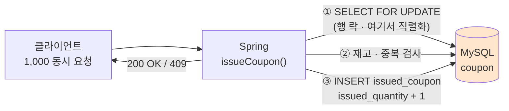
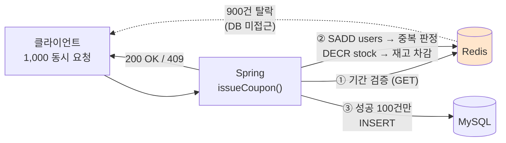
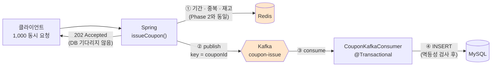

# 선착순 쿠폰 발급 시스템 — 동시성 제어 3단계 비교

**수만 명이 동시에 누르는 쿠폰 발급 버튼에서, 100개짜리 쿠폰을 정확히 100개만 발급하는 방법을 세 가지로 구현하고 같은 부하로 비교했습니다.**

같은 요구사항을 **DB 비관적 락 → Redis 원자적 연산 → Redis + Kafka 비동기**로 세 번 구현했습니다.
세 구현 모두 정확성(100개 / 중복 0)은 동일하게 만족하고, **차이는 응답 지연과 처리량에서 납니다.**

---

## 측정 결과

1,000명이 동시에 100개짜리 쿠폰을 요청했을 때입니다.

| | Phase 1<br>DB 비관적 락 | Phase 2<br>Redis 원자적 연산 | Phase 3<br>Redis + Kafka |
| --- | ---: | ---: | ---: |
| 처리량 | 937 req/s | 2,329 req/s | **3,893 req/s** |
| 응답 p95 | 967.75 ms | 303.08 ms | **158.57 ms** |
| 응답 평균 | 753.10 ms | 122.65 ms | **102.18 ms** |
| 1,000건 소요 | 1.1 s | 0.4 s | **0.3 s** |
| 발급 성공 | 100 | 100 | 100 |
| 정상 탈락 | 900 | 900 | 900 |
| 초과 발급 | 0 | 0 | 0 |

Phase 1 대비 Phase 3은 **p95가 6.1배 짧고 처리량이 4.2배**입니다.

> 측정 환경: Apple Silicon MacBook 1대, Docker 단일 노드(MySQL 8.0 / Redis 7 / Kafka 3.7.1 KRaft), k6 1,000 VU `shared-iterations`.
> 앱과 인프라가 같은 머신에 있으므로 **절대 성능이 아니라 세 구현의 상대 비교**로만 읽어야 합니다. 2026-09-12 측정.

정확성은 매 실행 후 `report.sh`로 3중 대조합니다.

```
[Redis]  잔여 재고 0 · 발급 유저 100
[MySQL]  issued_coupon 100행 · coupon.issued_quantity 100 / total 100
[정합성] Redis users == DB rows  ✅ 일치 (100건)
         DB rows == issued_qty   ✅ 일치 (100건)
```

---

## 왜 세 단계로 나눴나

한 번에 Kafka까지 가면 **어느 요소가 무엇을 해결했는지** 설명할 수 없습니다.
그래서 병목을 하나씩만 걷어내고, 단계마다 같은 부하를 걸어 효과를 분리했습니다.

| 단계 | 걷어낸 병목 | 남은 병목 |
| --- | --- | --- |
| Phase 1 | (기준선) 정확성 확보 | 1,000개 요청이 **DB 행 락 하나**를 두고 줄을 섬 |
| Phase 2 | 판정을 Redis로 옮겨 DB 락 제거 | 발급 성공 100건의 **DB INSERT가 응답 경로에 남음** |
| Phase 3 | DB 쓰기를 Kafka 뒤로 밀어 응답에서 분리 | 쓰기 지연(최종 일관성), 발행 실패 시 재고 보정 |

---

## 아키텍처

### Phase 1 — DB 비관적 락

`SELECT ... FOR UPDATE`로 쿠폰 행을 잠그고, 재고 확인부터 발급까지를 한 트랜잭션에 담습니다.
정확하지만 **1,000개 요청이 행 락 하나를 두고 직렬화**되고, 그동안 DB 커넥션을 붙잡습니다.



병목은 ①입니다. 락을 잡은 트랜잭션이 끝나야 다음 요청이 들어갑니다. p95가 967ms까지 올라간 이유입니다.

### Phase 2 — Redis 원자적 연산

판정을 Redis로 옮깁니다. **중복은 `SADD`, 재고는 `DECR`** 로 각각 원자적으로 처리합니다.
두 연산 모두 단일 명령이라 락이 필요 없고, 탈락할 900건은 **DB를 건드리지 않고 Redis에서 끝납니다.**



**순서가 중요합니다.** `SADD`(중복) → `DECR`(재고) 순으로 하고, 재고가 음수면 `INCR` + `SREM`으로 되돌립니다.
반대로 하면 재고를 깎은 뒤 중복으로 탈락한 요청의 재고가 복원되지 않아 **실제보다 적게 발급**됩니다.

DB 쓰기가 실패하면 `@Transactional`이 DB는 롤백하지만 **Redis는 롤백되지 않습니다.** 그래서 `rollback()`으로 보상 처리를 직접 넣었습니다.

### Phase 3 — Redis + Kafka 비동기

판정은 Phase 2 그대로 두고, **DB 쓰기만 응답 경로 밖으로** 뺍니다.
발급이 확정되면 Kafka에 이벤트를 발행하고 즉시 `202 Accepted`를 돌려줍니다. INSERT는 Consumer가 합니다.



- **`couponId`를 메시지 키로** 씁니다. 같은 키는 같은 파티션에 들어가므로 한 쿠폰의 발급 이벤트는 순서가 보장됩니다.
- **`enable-auto-commit: false`** — 리스너가 정상 종료한 뒤에 오프셋을 커밋합니다. INSERT가 실패하면 재전송됩니다.
- **멱등성** — Kafka는 at-least-once라 같은 메시지가 두 번 올 수 있습니다. Consumer가 `(coupon, user)` 존재를 먼저 확인하고 있으면 건너뜁니다.

---

## 검증

### 동시성 테스트

세 단계 모두 같은 두 시나리오를 통과합니다.

| 시나리오 | 기대 | 결과 |
| --- | --- | --- |
| 1,000명이 100개 쿠폰에 동시 요청 | 정확히 100명 성공 | 성공 100 · 탈락 900 |
| 동일 사용자가 100번 동시 요청 | 정확히 1번 성공 | 성공 1 |

```bash
cd <phase>/spring && ./gradlew test --tests '*CouponConcurrencyTest*'
```

`ExecutorService` + `CountDownLatch(1)`로 1,000개 스레드를 **같은 순간에 출발**시킵니다.
한 스레드로 순차 호출하면 레이스가 재현되지 않기 때문입니다.

`성공 + 탈락 == 1000`을 단언해 **삼켜진 예외가 없는지**도 같이 확인합니다.
이 단언이 없으면 예외가 조용히 사라져도 "성공 100건"만 보고 통과한 것으로 착각할 수 있습니다.

Phase 3은 DB 쓰기가 비동기라 즉시 단언하면 실패합니다. Awaitility로 Consumer가 따라잡을 때까지 기다립니다.

### 부하 테스트

```bash
cd <phase>
./reset-coupon.sh 1 100      # 쿠폰 재생성 + Redis 초기화
k6 run -e COUPON_ID=1 -e USERS=1000 k6/concurrent-issue.js
./report.sh 1                # Redis · DB 3중 정합성 대조
```

---

## 실행 방법

**세 Phase는 컨테이너 이름(`mysql` · `redis` · `kafka`)과 포트를 공유합니다. 한 번에 하나만 띄우세요.**

```bash
cd 1-coupon_db_lock          # 또는 2-coupon_redis / 3-coupon_redis_kafka
docker compose up -d         # MySQL (+ Redis / Kafka) + Prometheus + Grafana
cd spring && ./gradlew bootRun
```

다른 Phase로 옮길 때는 이전 Phase에서 `docker compose down`을 먼저 실행합니다.

- 요구 환경: JDK 17, Docker, k6
- 앱 `:8080` · MySQL `:3306` · Redis `:6379` · Kafka `:9092` · Grafana `:3000`
- compose의 계정은 **로컬 전용 더미값**입니다 (`coupon` / `coupon`).

---

## API

| Method | Endpoint | 설명 |
| --- | --- | --- |
| `GET` | `/api/coupons/available` | 발급 가능한 쿠폰 목록 |
| `POST` | `/api/coupons/{couponId}/issue` | 선착순 발급 (Phase 3은 `202`) |
| `GET` | `/api/coupons/{couponId}/stock` | 잔여 수량 |
| `POST` | `/api/coupons/{couponId}/stock/init` | Redis 재고 초기화 (Phase 2 · 3) |
| `GET` | `/api/coupons/users/{userId}` | 보유 쿠폰 |
| `GET` | `/api/coupons/users/{userId}/usable` | 사용 가능 쿠폰 |
| `POST` | `/api/coupons/{issuedCouponId}/use` | 쿠폰 사용 |

실패는 공통 봉투로 내려갑니다. 재고 소진 · 중복 발급은 `409`, 기간 외는 `400`, 없는 쿠폰은 `404`입니다.

---

## 하지 않은 것 · 알려진 한계

정확성을 보장하지 못하는 구간을 알면서 남겨둔 부분입니다.

- **Phase 3에서 Kafka 발행이 실패하면 Redis 재고가 이미 차감된 채로 남습니다.** Redis 차감과 이벤트 발행이 한 트랜잭션이 아니기 때문입니다. Outbox 패턴으로 풀어야 하는데 이 저장소에서는 구현하지 않았습니다.
- **Consumer 실패가 반복될 때의 DLQ가 없습니다.** 현재는 무한 재시도에 가깝습니다.
- **재고 원복 경로가 없습니다.** 쿠폰 사용 취소나 발급 철회 시 Redis 재고를 되돌리는 흐름은 만들지 않았습니다.
- **Redis가 단일 노드입니다.** Redis가 죽으면 발급 전체가 멈춥니다. 이중화와 AOF 설정은 다루지 않았습니다.
- **부하 수치는 단일 머신 측정입니다.** 앱·DB·Redis·Kafka가 한 노트북에 있어 절대 처리량으로 인용할 수 없습니다.
- **Phase 1은 커넥션 풀 고갈 지점까지 밀어보지 않았습니다.** 1,000 VU에서는 p95 967ms로 버텼고, 그 위 구간은 측정하지 않았습니다.

---

## 디렉터리

```
├── 1-coupon_db_lock/        Phase 1 — DB 비관적 락
├── 2-coupon_redis/          Phase 2 — Redis 원자적 연산
├── 3-coupon_redis_kafka/    Phase 3 — Redis + Kafka 비동기
│   ├── docker-compose.yml       인프라 (DB · Redis · Kafka · Prometheus · Grafana)
│   ├── k6/concurrent-issue.js   부하 시나리오
│   ├── reset-coupon.sh          쿠폰 · Redis 초기화
│   ├── report.sh                Redis · DB 정합성 대조
│   └── spring/                  애플리케이션
├── docs/                    단계별 학습 기록 · 설계 메모 · 측정 원본
├── load-test.html           브라우저에서 직접 눌러보는 발급 테스트 페이지
└── ASSIGNMENT.md            과제 원문
```

`docs/`에는 각 Phase를 만들면서 정리한 기록이 있습니다. `phase1-study.md`(DB 락) · `phase2-study.md`(Redis) · `phase3-study.md`(Kafka) · `redis_study.md` · `kafka_study.md` · `monitoring.md`.

---

## 기술 스택

Java 17 · Spring Boot 3 · Spring Data JPA · MySQL 8.0 · Redis 7 · Apache Kafka 3.7.1 (KRaft) · Docker Compose · k6 · Prometheus · Grafana · JUnit 5 · Awaitility

---

SW마에스트로 17기 멘토링 과제로 시작해 세 단계로 확장했습니다. 과제 명세는 [`ASSIGNMENT.md`](ASSIGNMENT.md)에 있습니다.
