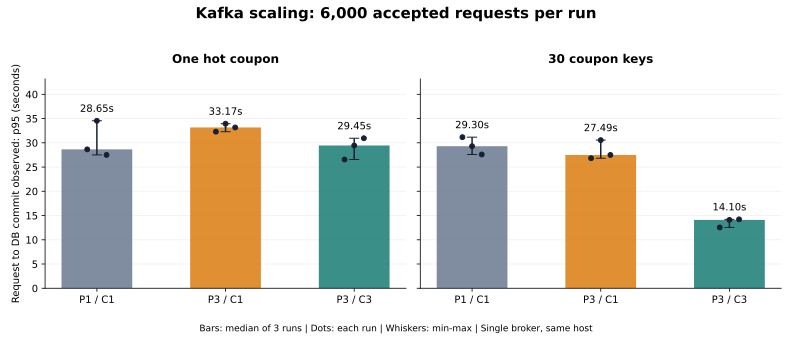
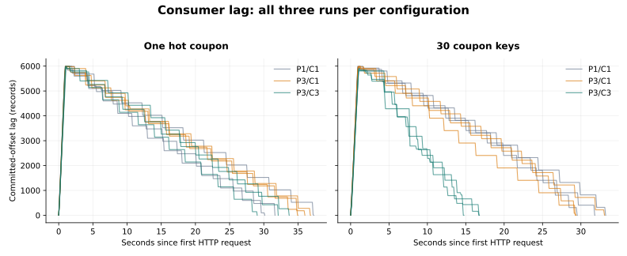

# Kafka 파티션 확장과 재시작·재전달 실증

**쿠폰 30개에 분산한 6,000건 부하에서 P1/C1 → P3/C3로 요청→DB 완료 p95 중앙값을 29.30초 → 14.10초(51.9% 감소)로 줄였다.** 쿠폰 하나에 집중한 부하에서는 6,000건이 한 파티션·한 Consumer 스레드에 모였고, 병렬 처리 효과를 얻지 못했다.

DB 커밋 후 오프셋 커밋 전의 **SIGKILL·재시작 실험은 3회 모두 통과**했다. 같은 Kafka offset의 재전달을 확인했고, 최종 DB 발급 행·발급 수량은 각각 51, 중복 그룹은 0이었다.

- 측정일: **2026-09-13 KST**. 원본 실행 디렉터리의 `20260912T154925Z`는 UTC 기준이다.
- 실행 코드: [`107feb393dee4795f672603bb969cd7a0a5608d5`](https://github.com/joejaeyoung/Project-coupon_rush/commit/107feb393dee4795f672603bb969cd7a0a5608d5). 시작 시 tracked diff 없음. 실행한 JAR의 SHA-256은 [실행 메타데이터](evidence/run.json)에 보관했다.
- 총 **18회 × 6,000건 = 본 측정 108,000건**, 별도 워밍업 27,000건. 본 측정의 DB·Redis 수량 불일치, 초과 발급, 중복 그룹은 모두 0.

## 1. 파티션 수와 Consumer 수 비교

P는 토픽 파티션 수, C는 같은 그룹의 Consumer 수다. 표의 지연과 처리율은 **각 조건을 세 번 실행한 값의 중앙값**이며, 범위는 세 관측값의 최소–최대다. 모든 요청을 통과시키는 재고를 준비했다.

| 부하 | 구성 | 요청→DB p95 중앙값 | p95 관측 범위 | HTTP p95 중앙값 | DB 완료 처리율 중앙값 |
| --- | --- | ---: | ---: | ---: | ---: |
| 쿠폰 1개 집중 | P1/C1 | 28.65초 | 27.50–34.54초 | 16.99ms | 189.85건/초 |
| 쿠폰 1개 집중 | P3/C1 | 33.17초 | 32.30–33.94초 | 17.46ms | 166.98건/초 |
| 쿠폰 1개 집중 | P3/C3 | 29.45초 | 26.56–30.94초 | 18.40ms | 187.33건/초 |
| 쿠폰 30개 분산 | P1/C1 | 29.30초 | 27.59–31.16초 | 17.33ms | 188.99건/초 |
| 쿠폰 30개 분산 | P3/C1 | 27.49초 | 26.82–30.55초 | 18.35ms | 204.80건/초 |
| 쿠폰 30개 분산 | P3/C3 | 14.10초 | 12.54–14.22초 | 19.02ms | 360.89건/초 |

**파티션 키에 따른 차이.** P3/C3의 분산 부하에서는 세 Consumer가 각각 하나의 파티션을 처리했다. 파티션 0/1/2의 처리 건수는 1회차 `2,200 / 2,000 / 1,800`, 2회차 `1,200 / 2,600 / 2,200`, 3회차 `1,400 / 2,600 / 2,000`이었다. 쿠폰 수를 균등하게 배분해도 키 해시 때문에 파티션별 건수는 달랐다.

집중 부하에서는 세 파티션을 세 Consumer에 배정해도 한 스레드가 6,000건을 처리했다. P1/C1과 P3/C3의 p95 중앙값은 28.65초와 29.45초였고, 관측 범위도 겹쳤다. 현재 `couponId` 키 전략에서 인기 쿠폰 하나의 처리를 Consumer 증설로 나눌 수 없다는 점을 처리 기록으로 확인했다.

P3/C1은 한 Consumer가 여러 파티션을 담당하는 대조군이다. 분산 부하의 p95 범위는 P1/C1과 겹쳤다. P3/C3에서는 분산 부하의 DB 완료 처리율 중앙값도 188.99 → 360.89건/초로 나타났다. 이 처리율에는 HTTP 입력 속도의 영향도 포함된다.

## 2. Consumer Lag

요청을 빠르게 접수한 뒤 Consumer에서 저장이 이어졌다. 분산 부하의 관측 최대 Lag 중앙값은 P1/C1 `5,990`건, P3/C3 `5,890`건으로 두 구성 모두 적체가 발생했다. 마지막 HTTP 응답 이후 DB 전량 저장과 Lag 0을 함께 확인하기까지의 시간 중앙값은 **30.85초 → 15.67초**였다.

Lag는 로그 끝 오프셋과 커밋 오프셋의 차이다. BATCH에서는 이미 DB에 저장한 레코드도 아직 커밋하지 않은 오프셋에 포함될 수 있다. 따라서 DB 완료 지연과 Lag를 각각 수집했다.

## 3. DB 커밋 후 SIGKILL·같은 offset 재전달

매 회 새 토픽·그룹·쿠폰을 사용했다. 이벤트 1건을 저장하고 offset 1 커밋을 확인한 뒤 Consumer의 소비를 일시 정지했다. 추가 50건이 Broker에 기록되어 `end=51, committed=1, lag=50`이고 DB에는 1건만 남아 있는 상태를 확인했다.

Consumer를 재개한 뒤 offset 1 이벤트의 DB 커밋이 끝나는 지점에서 멈췄다. 외부 MySQL 조회로 **DB 행 2건**, Kafka CLI로 **커밋 오프셋 1**을 확인했다. Java 프로세스에 SIGKILL을 보내 종료 코드 `-9`를 확인하고, 프로세스가 없는 상태에서도 DB와 오프셋이 같은지 대조했다.

| 반복 | 종료 후 DB 행 / 커밋 오프셋 | 종료 코드 | 재시작 후 재전달 | 최종 DB 행 / 발급 수량 / 중복 그룹 | 종료→검증 완료 |
| --- | --- | --- | --- | --- | ---: |
| 1 | 2건 / 1 | `-9` | partition 0 / offset 1 | 51건 / 51 / 0 | 8.97초 |
| 2 | 2건 / 1 | `-9` | partition 0 / offset 1 | 51건 / 51 / 0 | 9.09초 |
| 3 | 2건 / 1 | `-9` | partition 0 / offset 1 | 51건 / 51 / 0 | 8.69초 |

재시작 후 같은 `topic / partition / offset / userId`의 전달을 원본 기록으로 대조했다. Consumer의 기존 `(couponId, userId)` 조회가 이미 저장한 1건을 건너뛰고 남은 49건을 저장했다. 최종 오프셋은 51, Lag는 0, Redis 잔여 재고는 0, 사용자 집합은 51이었다. [복구 결과 원본](evidence/recovery-results.json).

체크포인트는 BATCH 모드에서 JPA 트랜잭션이 반환된 뒤의 `RecordInterceptor.success`다. DB 트랜잭션이 종료됐는지, 별도 조회에서 발급 행이 보이는지, Broker 커밋 오프셋이 해당 레코드를 넘지 않았는지 확인하고 파일에 fsync했다. [계측 코드](../../../3-coupon_redis_kafka/spring/src/lab/java/com/example/coupon/lab/LabProbe.java) · [Spring Kafka 3.3.1 호출 순서](https://github.com/spring-projects/spring-kafka/blob/v3.3.1/spring-kafka/src/main/java/org/springframework/kafka/listener/KafkaMessageListenerContainer.java).

종료→검증 완료 시간에는 외부 상태 조회·JVM 시작·그룹 재가입을 포함했다. Broker 장애 감지 시간이나 운영 복구 SLA로 해석하지 않는다. DB 유일 제약은 추가하지 않았으며, 이 결과는 같은 그룹의 재시작·재전달 구간을 검증한 것이다. 여러 독립 그룹의 동시 중복 처리, Redis 차감→Kafka 전송 실패, 다중 Broker 장애는 이번 범위에 포함하지 않았다.

## 측정 방법과 환경

| 항목 | 조건 |
| --- | --- |
| 호스트 | Apple Silicon Mac `Mac17,9`, 논리 CPU 15개, 메모리 48GiB |
| Docker VM | aarch64, CPU 8개, 메모리 약 7.65GiB |
| JVM | Amazon Corretto 17.0.10, 힙 512MB, ActiveProcessorCount 4 |
| 앱 | Spring Boot 3.4.1, Spring Kafka 3.3.1, Kafka Client 3.8.1, Hikari 최대 10 |
| Broker | Apache Kafka 3.7.1, KRaft 단일 노드, RF 1 |
| 저장소 | MySQL 8.0.46, Redis 7.4.9. MySQL flush-at-commit 1·sync-binlog 1 |
| Consumer | BATCH, auto-commit false, max.poll.records 500, max.poll.interval.ms 300,000 |
| 그룹 재가입 | session.timeout.ms 10,000, heartbeat.interval.ms 3,000 |
| 부하 | Python 3.14.4, 작업자 64개, 닫힌 루프 HTTP, 요청별 고유 userId |
| 워밍업 | 매 새 JVM에서 별도 쿠폰 30개·1,500건 처리 후 Lag 0 확인 |
| 본 부하 | 집중: 쿠폰 1개·재고 6,000 / 분산: 쿠폰 30개·각 재고 200 |
| 반복 | 조건별 3회, 고정 시드로 순서를 섞음. 인프라 재사용, 매 회 새 JVM·토픽·그룹·쿠폰 |

요청→DB 지연은 **HTTP 요청 시작부터 DB 커밋 후 콜백 시각까지**다. 같은 호스트의 epoch 시계로 결합하고 1ms 해상도로 DB 완료를 관측했다. 콜백 오버헤드를 포함한다. HTTP 응답 시간은 별도로 저장했다. 원본을 NumPy 선형 보간으로 다시 계산해 p95와 대조했다.

Lag 샘플은 Admin 조회 응답 후 100ms 간격으로 수집했다. 커밋 오프셋과 로그 끝 조회는 원자적이지 않으며, 기록한 최대값은 샘플에서 관측한 최대다. 물리 CPU를 독점하거나 JVM CPU quota를 제한하지 않았다. 다른 로컬 작업·인프라 캐시·실행 시점의 영향을 받을 수 있고, 세 번의 범위는 신뢰구간이 아니다.

기존 `docs/benchmark-2026-09-12.md`는 **1,000 VU·재고 100개, 성공·접수·탈락을 섞은 HTTP 응답**을 비교했다. 이번 수치는 **64개 작업자·전량 유효한 6,000건의 요청→DB 완료**이므로 기존 HTTP p95와 직접 비교하지 않는다.

## 재현과 검증 자료

[실행 가이드](../../../experiments/kafka/README.md)의 `--mode all`로 재현할 수 있다. [실행기](../../../experiments/kafka/run.py)가 조건과 정합성을 단언하고, [원본 대조·그래프 생성기](../../../experiments/kafka/summarize.py)가 보고값을 다시 확인한다.

- [18회 결과 CSV](evidence/benchmark.csv) · [6조건 중앙값·범위](aggregate.json)
- [실행 완료 기록](evidence/completion.json) · [108,000건 원본 대조 결과](audit.json)
- [환경·이미지 ID](evidence/environment.json) · [JUnit 결과 요약](evidence/regression-tests.xml) · [일반 JAR 분리 검증](evidence/validation.json)
- [요청·완료·Lag·DB 상태·설정 원본](evidence/) · [원본 SHA-256 목록](sha256sums.txt)
- 기존 `CouponConcurrencyTest` 2건도 통과했다. 일반 `bootJar`에 실험용 API·장애 주입 클래스가 없는지 확인했다.

실험을 수행한 코드는 별도 브랜치 `experiment/kafka-scaling-recovery`에 있다. 일반 JAR와 실험용 `-kafka-lab.jar`를 분리해 계측·정지 주입을 관리한다.
