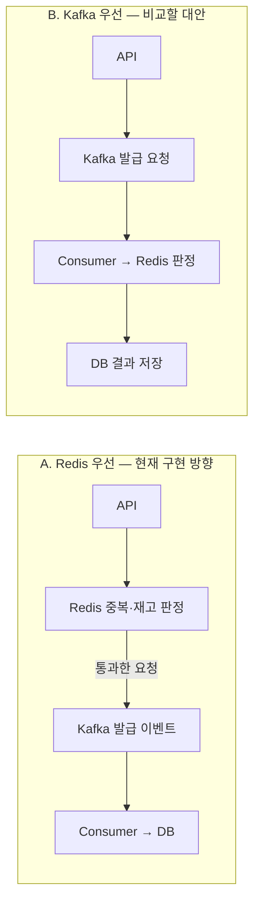

# 선착순 쿠폰 멘토링 — 다섯 가지 설계 질문과 기술적 고민

> 정리: 2026-10-22 · 상태: **설계 질문 + 별도 모듈의 구현·실증 연결**
> 팀에서 모은 키워드를 코드와 연결한 문서다. 설계 선택은 멘토님의 답변이나 팀의 확정 아키텍처가 아니다. 본문의 기존 구현 설명은 Phase 1~3 기준이며, 후속 구현·관측은 [실증 보고서](experiments-2026-10-22.md)에서 구분한다.
> 기존 구현·측정 요약은 [README](../README.md), 단계별 기록은 [Phase 2](phase2-study.md)와 [Phase 3](phase3-study.md)를 참고한다.

## 멘토님께 가져갈 키워드

| 주제 | 함께 논의할 질문 |
| --- | --- |
| **1. Kafka와 Redis의 처리 순서** | Kafka에 요청을 먼저 적재할 때와 Redis에서 재고를 먼저 확인·차감할 때, 병목·복구·사용자 결과 안내가 어떻게 달라지는가? |
| **2. 동시성 제어** | Redis의 중복 확인과 재고 차감을 어떤 단위로 원자화해야 하는가? 원자적 실행으로 해결되지 않는 장애는 무엇인가? |
| **3. 트래픽 분포와 확장** | 다수 쿠폰의 키 분포와 단일 인기 쿠폰의 hot partition / hot key를 어떻게 구별하고, 서버 증설은 어디까지 효과가 있는가? |
| **4. 고가용성과 장애 시 정합성** | Redis failover, Kafka 장애·재처리, Redis 차감 후 Kafka 미발행 상황에서 무엇을 기준으로 복구하는가? |
| **5. Kafka를 앞단에 둘 때의 순서 보장** | 선착순의 기준을 어디에 두고, 재시도·병렬 소비·리밸런싱에도 그 기준을 어떻게 유지하는가? |

논의는 **선착순·접수·발급 완료의 정의(5 → 1)**부터 맞춘 뒤, **원자성(2) → 장애 복구(4) → 확장 한계(3)** 순서로 진행하면 설계 선택의 이유를 설명하기 쉽다.

## 기존 Phase 1~3에서 출발하기

아래 표는 후속 실험 전의 기준선이다. [실험 모듈](../4-coupon_experiments/README.md)은 다섯 경로, Lua 원자적 판정, DB 유일 제약, 요청 상태 조회, Outbox/Stream relay를 추가했다. 기존 Phase 1~3 파일은 그대로 보존했다.

| 항목 | 코드로 확인한 사실 | 아직 보장하지 않는 것 |
| --- | --- | --- |
| 처리 순서 | [CouponService](../3-coupon_redis_kafka/spring/src/main/java/com/example/coupon/service/CouponService.java)의 Redis 기간 검사 → 중복·재고 처리 → Kafka 발행 → Consumer DB 저장 | Kafka 우선 구조는 비교 대상이며 구현되어 있지 않음 |
| Redis 원자성 | [CouponRedisService](../3-coupon_redis_kafka/spring/src/main/java/com/example/coupon/service/CouponRedisService.java)의 `SADD`, `DECR`, 소진 시 `INCR`·`SREM` 개별 호출 | 여러 명령의 단일 원자적 실행, 프로세스 종료 시 복구 |
| 접수 응답 | [Producer](../3-coupon_redis_kafka/spring/src/main/java/com/example/coupon/service/CouponKafkaProducer.java)가 `send()`의 Future를 확인하지 않고 [Controller](../3-coupon_redis_kafka/spring/src/main/java/com/example/coupon/api/CouponController.java)가 `202` 반환 | 브로커 ACK 확인, `requestId` 발급, 요청별 상태 조회·푸시 알림 |
| Consumer | [Consumer](../3-coupon_redis_kafka/spring/src/main/java/com/example/coupon/service/CouponKafkaConsumer.java)가 DB 존재 조회 후 발급 수 증가·INSERT를 DB 트랜잭션으로 실행 | [엔티티](../3-coupon_redis_kafka/spring/src/main/java/com/example/coupon/domain/issuedCoupon/IssuedCoupon.java)에 `(coupon_id, user_id)` 유일 제약 선언이 없음. 동시 중복 처리까지 막는 최종 방어가 부족함 |
| Kafka 설정 | `couponId` 키, [설정](../3-coupon_redis_kafka/spring/src/main/resources/application.yml)의 `enable-auto-commit: false` | 파티션 수·ACK 모드·오류 처리기·DLT 정책을 코드에 명시하지 않음. 명시되지 않은 Producer 옵션이 비활성이라는 뜻은 아님 |
| 인프라 | [Compose](../3-coupon_redis_kafka/docker-compose.yml)는 Redis·Kafka 단일 노드. [Redis 설정](../3-coupon_redis_kafka/redis/redis.conf)에 AOF `everysec`과 RDB가 있음 | 복제본 failover, 브로커 장애 내성, 장애 후 자동 정합성 복구 |
| 검증 | [동시성 테스트](../3-coupon_redis_kafka/spring/src/test/java/com/example/coupon/CouponConcurrencyTest.java)는 정상 상황의 수량·동일 사용자 동시 요청을 확인 | Consumer 직접 중복 재주입, 장애·failover, 엄격한 순서, 다중 쿠폰 편중 부하는 미검증 |

**먼저 합의할 조건:** 최종 발급 수가 총량을 넘지 않고, 사용자별 동일 쿠폰 발급은 한 번이어야 한다. 접수한 요청은 완료·거절 또는 복구 중인지 추적 가능해야 한다. 여기에 “먼저 온 유효 요청이 반드시 먼저 발급된다”까지 요구하는지는 별도의 제품 정책이다. 초과 발급 방지와 선착순 공정성은 각각 검증해야 한다.

## 1. Kafka와 Redis의 처리 순서

### 두 구조에서 Kafka가 맡는 역할



| 비교 축 | A. Redis 우선 | B. Kafka 우선 |
| --- | --- | --- |
| 유입 부하 | 모든 요청이 Redis에 도달하고 통과한 요청만 Kafka에 보냄 | 입구의 인증·제한을 통과한 요청을 Kafka에 기록. 소진·중복 요청도 뒤에서 판정 |
| 병목 | Redis 인기 키와 API 요청 처리 경로 | Kafka 기록 처리량, 인기 파티션, Consumer 판정·DB 저장 속도 |
| 사용자 경험 | 중복·소진은 즉시 응답 가능. 재고 확보 후에도 DB 완료는 별도 | 접수 후 기다렸다가 소진·중복으로 거절될 수 있음 |
| 복구 출발점 | Redis 예약과 이벤트 발행 사이의 누락을 찾을 기록이 필요 | ACK 받은 요청 로그에서 재처리 가능. Redis 변경 후 재처리의 멱등성은 여전히 필요 |
| 순서 기준 후보 | Redis에서 원자적으로 예약을 승인한 순서 | 같은 쿠폰의 요청이 Kafka 파티션에 기록된 순서 |
| 비용 | DB 비동기화에 필요한 이벤트 위주로 적재 | 전체 요청의 저장·보존 비용, 대기 시간·적체량 관리가 필요 |

Kafka 우선 구조도 Redis·DB의 처리 능력보다 유입이 오래 많으면 lag가 계속 늘어난다. 큐는 순간 부하를 시간에 걸쳐 처리하게 해 주지만 처리 용량을 무한히 늘리지는 않는다. 앞단 유입 제한과 최대 대기 시간도 함께 정해야 한다.

### 접수와 발급 완료를 사용자에게 전달하기

기존 Phase 3의 개선안은 동일 요청을 재시도해도 유지되는 `requestId`와 요청 상태 조회다. 후속 실험 모듈에는 이를 구현해 처리 중·발급·거절·취소를 조회한다. 네트워크 timeout은 결과를 알 수 없는 상태일 수 있으므로 바로 `REJECTED`로 확정하지 않는다.

- `202 Accepted`는 처리 접수이며 발급 완료가 아니다. Kafka 우선이면 브로커 ACK, DB Outbox 방식이면 예약·Outbox 커밋처럼 **재시작 후 복구 가능한 기록의 확인 시점**을 접수 기준으로 삼는 안을 비교한다. ACK의 내구성은 복제·저장 설정에도 의존한다.
- 기본 결과 전달은 요청별 상태 폴링으로 두고, 필요하면 SSE/WebSocket으로 완료를 알린다. 연결이 끊겨도 상태 API로 결과를 다시 확인할 수 있어야 한다.
- 기존 Phase 3의 보유 쿠폰 목록 조회는 완료 여부 일부만 보여 준다. 목록에 없다는 사실만으로 대기·실패·유실을 구분할 수 없고, 이 단계에는 요청별 상태 API가 없다. 후속 실험 모듈은 `GET /lab/runs/{runId}/requests/{requestId}`로 요청 상태를 조회한다.
- API 응답 p95와 **접수부터 최종 발급/거절까지의 p95**를 나눠 측정한다. 현재 Phase 3의 빠른 `202`와 동기 발급의 `200`은 완료 시점이 다르다.

**멘토님께 질문:** 현재 규모에서는 Redis 우선의 즉시 탈락과 Kafka 우선의 요청 기록·대기열 중 어떤 이점을 우선해야 할까요? `202`를 반환하기 전에 어느 저장소의 기록까지 확인하는 것이 적절할까요?

## 2. 동시성 제어

### 단일 명령의 원자성과 전체 판정의 원자성

기존 Phase 2/3의 `SADD → DECR` 사이에 프로세스가 종료되면 사용자는 중복 집합에 남지만 재고 차감·이벤트 발행은 진행되지 않을 수 있다. `DECR` 후 종료되면 예약만 남을 수 있다. 정상 동시성 테스트 통과만으로 이 중간 상태의 복구까지 증명할 수 없다.

기존 Phase 2/3의 개선 후보는 Redis Lua 또는 Redis Functions로 다음 판정을 한 번에 실행하는 것이다. 아래는 **검토용 의사 흐름이며 모든 검증 항목을 구현했다는 뜻은 아니다.** 후속 실험 모듈은 Lua로 요청 ID·중복·재고를 판정하고 예약·순번을 기록한다. 기간·키 타입 검증이나 Redis Functions 도입까지 포함한 구현은 아니다.

```text
1. 키 존재·타입·기간 등 실행 전제 검증
2. 동일 requestId의 처리 결과가 있으면 기존 결과 반환
3. 동일 사용자의 다른 예약/발급이 있으면 중복 반환
4. stock <= 0이면 소진 반환
5. 재고 -1, 사용자 예약·requestId 기록 후 RESERVED 반환
```

Lua는 실행 중 다른 요청의 명령이 끼어들지 않게 한다. 하지만 스크립트 오류 때 앞선 쓰기를 자동 롤백하는 DB 트랜잭션과 같지 않으며, Redis 밖의 Kafka·MySQL까지 원자화하지도 않는다. 쓰기 전에 조건·타입을 검사하고 스크립트를 짧게 유지해야 한다. [Redis Lua 설명](https://redis.io/docs/latest/develop/programmability/eval-intro/)

`WATCH` + `MULTI/EXEC`도 조건부 갱신의 후보지만 인기 키 경합에서는 충돌 재시도 비용을 측정해야 한다. 분산 락을 추가하는 것만으로 Redis와 Kafka 사이의 장애 구간이 없어지지는 않는다.

### Cluster에 옮길 때의 키 설계

여러 키를 한 스크립트에서 다루려면 Redis Cluster의 같은 hash slot에 배치해야 한다. 예를 들어 **실제 문자열** `coupon:{1}:stock`, `coupon:{1}:users`, `coupon:{1}:requests`는 `{1}` hash tag를 공유한다. 기존 Phase 2/3의 키는 `coupon:1:stock`처럼 중괄호가 없다. 후속 실험 모듈은 `lab:{runId:couponId}:` prefix로 같은 쿠폰의 키를 묶고, 별도 Cluster 실험에서 다른 슬롯의 `CROSSSLOT` 오류와 같은 슬롯의 Lua 성공을 확인했다. 쿠폰 API 전체를 Cluster에 연결한 검증과는 구분한다. 같은 슬롯 배치는 원자적 처리에 필요하지만 인기 쿠폰의 부하도 한 노드에 모은다. [Redis Cluster hash tags](https://redis.io/docs/latest/operate/oss_and_stack/reference/cluster-spec/)

예약 취소도 `RESERVED → CANCELLED` 전이가 성공한 요청에 한해 한 번만 재고를 돌려줘야 한다. 같은 보상 이벤트를 두 번 받아도 두 번 `INCR`되지 않아야 하고, 이미 `ISSUED`인 요청을 취소하면 안 된다. 예약 만료와 늦게 도착한 발급 이벤트가 경쟁할 때도 동일한 상태·버전을 검사해야 한다.

이 검사는 **발급 확정과 취소가 권위 있는 저장소에서 원자적으로 경쟁하는 상태 전이**여야 한다. Redis에서 `RESERVED`를 읽고 나중에 DB에 INSERT하는 것만으로는 부족하다. 그 사이 취소가 재고를 돌려줄 수 있기 때문이다. DB를 원장으로 삼는다면 같은 예약 행의 조건부 상태 변경과 발급 INSERT를 한 DB 트랜잭션으로 묶는 식으로, 최종 쓰기 시점까지 경쟁을 차단해야 한다.

**멘토님께 질문:** 중복·재고 외에 요청 상태나 발행 대기 기록까지 Redis의 한 원자적 처리에 넣는 것이 적절할까요? 정상 요청 지연과 복구 가능한 상태 기록 사이의 경계를 어디에 둘까요?

## 3. 트래픽 분포와 확장

### 쿠폰이 많아도 요청이 고르게 퍼진다는 보장은 없다

`couponId` 해시는 키 종류를 분산한다. 쿠폰 1개에 요청의 90%가 몰리면 키가 만 개여도 해당 파티션·Redis 슬롯은 뜨거워진다. 여러 쿠폰이 같은 파티션을 공유하면 인기 쿠폰 때문에 다른 쿠폰도 지연될 수 있다.

파티션 수는 쿠폰 개수만 보고 정하지 않고 다음을 함께 측정한다.

- Kafka로 들어오는 초당 요청 수 `λ`, **실제 Redis·DB 처리까지 포함한** 파티션당 지속 처리량 `μ`, 목표 사용률 `u < 1`.
- 균등 분포에서의 시작 추정은 `P >= ceil(λ / (μ × u))`. 실측 전 용량 보장이 아니며, 편중 시에는 각 파티션의 유입량이 처리량보다 작은지도 별도로 확인한다.
- 한 쿠폰을 한 파티션에서 직렬 처리하면 그 쿠폰의 유입량 자체가 해당 처리 한도 이하여야 한다. 총 파티션 수를 늘려도 이 조건은 사라지지 않는다.
- Consumer 병렬 수, 브로커 디스크·네트워크, DB 커넥션·행 갱신 경합, 장애 후 적체를 해소할 여유 용량까지 함께 본다.

현재 Redis 우선 구조는 통과한 요청만 Kafka에 들어간다. 따라서 Kafka hot partition 실험과 Redis hot key 실험은 입력량을 따로 기록해야 한다. 재고 100개의 이벤트 100건만으로 Kafka의 지속 처리 한계를 측정했다고 볼 수 없다.

### 서버 증설로 해결할 수 있는 범위

| 증설 대상 | 효과가 있는 범위 | 남는 한계 |
| --- | --- | --- |
| API 서버 | 인증·연결·요청 처리 부하 분산 | 공유 Redis 인기 키나 같은 Kafka 파티션의 직렬 판정은 그대로 |
| Kafka 브로커·파티션 | 여러 키의 로그·리더 부하 분산 | 동일 키의 한 파티션을 자동으로 나눠 처리하지 않음 |
| 같은 그룹의 Consumer | 서로 다른 파티션을 병렬 소비 | 활성 Consumer 수는 파티션 수에 제한됨. 한 파티션의 엄격한 순차 처리에는 한계 |
| Redis Cluster 노드 | 서로 다른 슬롯의 쓰기 부하 분산 | 한 키와 같은 슬롯의 스크립트는 하나의 primary가 담당. replica 추가로 해당 쓰기를 나눌 수 없음 |
| DB 확장·튜닝 | 쓰기·조회 여유, 배치 효율 개선 | 같은 쿠폰 행의 발급 수 증가 등 공유 갱신 경합은 별도 확인 필요 |

단일 인기 쿠폰에는 입장 대기열·rate limit·짧은 원자적 처리·불필요한 왕복 감소를 먼저 비교한다. 더 큰 병렬성이 필요하면 재고를 여러 버킷에 사전 할당하는 안도 있지만, **버킷별 할당 합계 ≤ 총량**, 사용자 중복 방지, 잔여량 재분배가 필요하다. 단순 키 분할만으로 전체 선착순까지 유지되지는 않는다.

또한 운영 중 파티션 수를 바꾸면 기본 키 해시의 목적지가 달라질 수 있다. 같은 쿠폰의 과거·신규 이벤트가 다른 파티션에 놓이는 상황을 피하도록 이벤트 기간에는 수를 고정하거나, 유입 중단·기존 큐 소진·새 토픽 전환 절차를 설계한다.

**멘토님께 질문:** 다수 쿠폰 균등 부하와 단일 쿠폰 편중 부하에서 어떤 지표를 보고 증설을 결정해야 할까요? 한 쿠폰의 엄격한 순서와 처리량이 충돌할 때 어느 요구를 조정할 수 있을까요?

## 4. 고가용성과 장애 시 정합성

### 장애 시나리오별로 남는 상태

| 장애 시점 | 가능한 상태·문제 | 검토할 복구 원칙 |
| --- | --- | --- |
| Redis `SADD` 후 API 종료 | 중복 정보만 있고 재고 차감·Kafka 이벤트 없음 | 판정 원자화, 요청별 상태 기록과 미완료 예약 대조 |
| Redis 차감 후 Kafka 호출 전 종료 | 예약 재고는 줄었지만 DB 발급으로 이어질 이벤트 없음 | 재발행 가능한 원장·발행 대기 기록 필요 |
| Kafka 기록 후 ACK/HTTP 응답 유실 | 클라이언트는 실패로 보지만 이벤트는 존재할 수 있음 | 동일 `requestId`로 조회·재시도. timeout만 보고 재고를 즉시 원복하지 않음 |
| DB 커밋 후 offset 커밋 전 종료 | 동일 Kafka 이벤트가 다시 전달됨 | DB 유일 제약·처리 기록으로 중복 효과 차단 |
| Consumer의 영구 오류 | 뒤 요청 지연 또는 오류 처리 정책에 따른 건너뛰기 | 재시도 한도·DLT·알림·재처리 책임과 예약 처리 정책 명시 |
| Redis failover 시 최근 쓰기 유실 | 재고가 늘거나 중복 정보가 사라져 재승인 가능 | 신규 판정 일시 중단, 확정 발급과 미완료 예약을 모두 대조 후 재개 |
| Kafka 브로커 장애·보존 기간 초과 | 접수 실패·지연 또는 재처리할 로그 부재 | 복제·ACK·ISR 정책, 보존 기간과 복구 시간, 로그 보관 범위 설계 |

### 복제와 멱등성이 담당하는 범위

Redis의 AOF `everysec`은 장애 시 최근 쓰기 손실 가능성을 남긴다. Sentinel/Cluster failover도 비동기 복제의 손실 가능성과 별개로 검토해야 한다. `WAIT`로 복제 확인을 강화해도 모든 failover에서 강한 일관성을 보장하는 것은 아니다. [Redis persistence](https://redis.io/docs/latest/operate/oss_and_stack/management/persistence/), [Redis replication](https://redis.io/docs/latest/operate/oss_and_stack/management/replication/)

Kafka는 예를 들어 업무 토픽의 replication factor 3, `min.insync.replicas=2`, Producer `acks=all`을 함께 고려할 수 있다. ISR이 부족하면 쓰기를 거절해 가용성을 줄이는 선택이다. 내부 offset 토픽의 복제 설정만으로 업무 토픽까지 복제되는 것은 아니다. 현재 단일 브로커 실습과는 별도 구성이다. [Kafka topic 설정](https://kafka.apache.org/37/configuration/topic-level-configs/)

Producer의 멱등성은 전송 재시도 중 로그 중복을 줄이는 장치다. 사용자의 새 API 요청이나 Consumer의 외부 DB 쓰기를 모두 한 번으로 만들어 주지 않는다. 최종 DB에는 `(coupon_id, user_id)` 유일 제약과 필요 시 `requestId` 처리 원장을 두고, 발급 행·발급 수·결과 상태를 같은 DB 트랜잭션에서 변경하는 안을 검토한다. 충돌 시 수량 증가도 롤백되어야 한다. [Kafka 전달 의미와 외부 저장소](https://kafka.apache.org/37/design/design/)

재고 유실 후 서로 다른 사용자가 재승인되면 사용자별 유일 제약만으로 **총량 초과**를 막을 수 없다. 최종 저장에도 총량 조건부 갱신 같은 방어를 둘지, 신뢰할 예약 원장 복구 전 발급을 멈출지 결정해야 한다.

### Redis 차감 성공 + Kafka 발행 실패를 어떻게 복구할까

`@Transactional` 안에서 **Redis를 차감한 다음 DB Outbox에 저장**하는 것만으로는 해결되지 않는다. Redis 성공과 DB 트랜잭션 시작·커밋 사이에 여전히 장애 구간이 남는다. Outbox가 원자적으로 묶는 것은 **같은 DB 트랜잭션의 업무 상태 변경과 발행할 이벤트 저장**이다. [Transactional Outbox](https://docs.aws.amazon.com/prescriptive-guidance/latest/cloud-design-patterns/transactional-outbox.html)

| 대안 | 함께 기록할 것 | 남는 고민 |
| --- | --- | --- |
| DB 예약 원장 + Outbox | 권위 있는 예약·총량 판정과 Outbox를 같은 DB 트랜잭션에 저장 | DB 쓰기가 접수 경로에 들어옴. Redis는 사전 필터·조회 보조 등으로 역할 재정의 |
| Redis 예약 + 발행 대기 기록 | 같은 슬롯에서 예약과 Redis Stream 등의 대기 기록을 Lua로 처리하고 relay가 Kafka로 전송 | 스크립트 오류·Redis 내구성·failover 한계는 남음. relay 중복 전송, 보존·정리 정책 필요 |
| Kafka 우선 | ACK 받은 요청 로그를 먼저 남기고 Consumer가 판정 | Redis 처리 후 Consumer 종료 시 같은 요청을 새 중복 거절로 바꾸지 않도록 기존 예약 결과를 재사용해야 함 |

어느 안이든 결과 불명인 예약을 무조건 `INCR`로 복구하면 늦은 이벤트가 발급되는 동안 새 사용자에게 재고를 내줄 수 있다. 재발행·취소는 요청 상태와 버전을 대조해 한 번만 수행하고, 취소된 예약의 늦은 이벤트를 Consumer가 거절하도록 설계해야 한다. 이때도 앞 절의 원자적 상태 전이 조건이 필요하며, Redis 상태 사전 조회만으로 DB의 늦은 커밋을 차단할 수는 없다.

복구 기준도 미리 정해야 한다. DB 확정 발급만 보고 Redis를 재구성하면 Kafka에 남아 있는 미완료 예약을 놓친다. 반대로 요청 로그만 재생할 때도 현재 시각의 기간 검사로 과거 승인 결과가 바뀔 수 있다. 확정 결과·예약 원장·처리 위치를 함께 관리하고 복구 중 신규 쓰기와 경합하지 않도록 해야 한다.

현재 `stock/init`은 총량으로 초기화하는 실습용 기능이다. 운영 중 복구 수단으로 실행하면 미완료 예약과 이미 발급된 수량을 반영하지 못한다.

**멘토님께 질문:** Redis를 권위 있는 예약 저장소로 유지할까요, DB 예약 원장이나 Kafka 요청 로그를 기준으로 재구성할까요? 장애 시 잠시 접수를 멈추는 것과 계속 받아 복구하는 것 중 어떤 정합성·가용성 기준을 세워야 할까요?

## 5. Kafka를 앞단에 둘 때의 순서 보장

### “먼저”의 기준점부터 정하기

| 기준 | 의미 | 주의할 점 |
| --- | --- | --- |
| API 요청 도착 | 지정한 단일 입구에서 관측한 도착 순서 | 여러 API 서버의 로컬 시각만으로 전체 순서를 확정하기 어려움. 입구의 순번 부여·기록 정책 필요 |
| Kafka 기록 | 동일 쿠폰 요청이 같은 파티션에서 받은 offset 순서 | Kafka 도달 전 네트워크·Producer 지연까지 반영한 순서. API 도착 순서와 다를 수 있음 |
| Redis 예약 승인 | 하나의 원자적 판정에서 승인한 순서 | 기존 Phase 2/3에는 승인 순번이 없음. 후속 Lua 실험 경로는 예약과 함께 순번을 기록하지만 Kafka 발행·최종 완료 순서까지 자동으로 같아지는 것은 아님 |
| 실제 DB 발급 | DB에 최종 발급이 커밋된 순서 | 앞선 판정을 병렬 처리하면 순서가 달라질 수 있음. 화면에 응답이 도착한 순서와도 다름 |

**논의 가설:** Kafka 우선 비교 실험에서는 “같은 쿠폰의 파티션에 먼저 기록된 유효 요청부터 판정한다”를 기준으로 두면 offset을 이용해 검증할 수 있다. 중복·기간 외·소진 등 무효 요청의 처리 규칙도 함께 정한다. 이는 팀의 확정 정책이 아니다.

### 같은 키만으로 끝나지 않는 조건

1. **Producer:** 파티션 수·키 직렬화·파티셔너를 일관되게 유지한다. `enable.idempotence=true`, `acks=all`, 양수 재시도, `max.in.flight.requests.per.connection <= 5` 등 호환 설정은 Producer 전송 재시도의 순서를 지키는 조건이다. 여러 Producer 사이의 API 도착 순서까지 정렬해 주지는 않는다. [Kafka Producer 설정](https://kafka.apache.org/37/configuration/producer-configs/)
2. **애플리케이션 재시도:** 새 이벤트로 다시 보내면 새로운 offset을 받는다. 같은 `requestId`의 최초 기록·결과를 재사용하고, 아직 기록되지 않은 요청의 원래 도착 순번을 복구할 수 있는지는 별도 정책으로 둔다.
3. **Consumer 병렬 처리:** 쿠폰별 판정 순서가 중요하면 같은 파티션 안의 판정·상태 반영을 순차 처리한다. 리스너가 비동기 작업만 시작하고 반환하면 실제 완료 순서는 보장되지 않는다. 다른 파티션의 병렬 처리는 가능하다.
4. **실패·재시도:** 앞 요청이 실패했는데 뒤 요청을 먼저 판정하면 원래 순서의 선착순에서 벗어날 수 있다. 파티션을 멈춰 순서대로 재시도하면 대기 시간이 늘어난다. retry topic/DLT로 옮기고 계속 진행하면 나중에 복귀한 요청을 어떻게 취급할지 정해야 한다. [Spring Kafka 비동기 재시도의 순서 한계](https://docs.spring.io/spring-kafka/reference/retrytopic/how-the-pattern-works.html)
5. **리밸런싱:** 파티션 소유권 변경 전후 미커밋 요청은 재처리될 수 있다. DB 멱등성을 확보하고, 이전 Consumer에서 떼어낸 작업이 새 Consumer와 동시에 쓰지 않게 종료·소유권 검증을 설계한다. 외부 비동기 작업을 쓰면 세대 번호 등 오래된 작업을 차단할 장치도 검토한다.
6. **Offset 커밋:** `enable-auto-commit: false`만으로 레코드마다 즉시 커밋하거나 무한 재시도하는 것은 아니다. Spring의 기본 `AckMode`는 `BATCH`이며 구체적 커밋 시점·복구 동작은 컨테이너와 오류 처리 정책에 달린다. DB 커밋 후 offset 커밋 전에 종료되는 구간은 멱등성으로 다뤄야 한다. [Spring Kafka offset 커밋](https://docs.spring.io/spring-kafka/reference/kafka/receiving-messages/message-listener-container.html)

Redis 우선 구조에서도 예약 A가 먼저 성공한 뒤 멈추고 예약 B의 Kafka 발행이 먼저 끝날 수 있다. 따라서 Kafka 이벤트 순서를 곧 Redis 예약 순서라고 설명하면 안 된다. 예약 순위가 필요하면 원자적 판정에서 순번을 함께 기록하고 이후 단계에서 그 순번을 보존해야 한다.

**멘토님께 질문:** 엄격한 선착순을 지키기 위해 앞 요청의 복구가 끝날 때까지 뒤 요청을 막아도 될까요? DLT로 분리된 요청의 순위·예약 권리를 유지할지, 거절 후 다음 요청으로 넘어갈지 어떤 기준으로 결정할까요?

## 논의를 확인할 실험과 관측값

아래는 실험을 설계할 때 정한 질문·관측 항목이다. 이에 대응하는 구현과 실행 결과는 [2026-10-22 실증 보고서](experiments-2026-10-22.md), 재현 명령은 [실험 모듈](../4-coupon_experiments/README.md)에 남겼다. 기존 [벤치마크](benchmark-2026-09-12.md)는 당시 정상 부하의 비교 근거로 보존한다. 모든 관측 항목을 운영 수준으로 수집한 것은 아니며, 실제 측정 범위와 미검증 범위는 보고서를 기준으로 판단한다.

| 실험 | 재현 방법 | 확인할 값·판정 기준 |
| --- | --- | --- |
| Redis 우선 vs Kafka 우선 | 동일 재고·사용자·유입률·내구성 설정으로 비교 | API p95, 최종 결과 p95, Kafka 유입량, Redis 명령 수, 거절 시점 |
| 분리 명령 vs 원자적 판정 | `SADD` 직후·예약 직후 API 프로세스 종료 | 중복 정보만 남는 요청, 재고 누수, 복구 가능한 요청 기록 |
| 균등 vs 편중 | 여러 쿠폰 균등 / 한 쿠폰에 90% / 한 쿠폰에 100% 요청 | 파티션별 유입·lag, Redis 노드 지연·CPU, DB 처리 시간. 재고·실험 시간을 충분히 확보 |
| 증설 효과 | API·Consumer·파티션 수를 각각 변화 | 총 처리량과 가장 느린 쿠폰의 지연. 같은 키 병목이 남는지 확인 |
| 발행 성공 여부 불명 | 예약 후 API 종료, Kafka 기록 후 응답 경로 차단 | 동일 requestId 재시도 결과, 미발행 예약, 중복 이벤트, 보상 중복 여부 |
| Consumer 재처리 | DB 커밋 직후 종료하고 동일 이벤트 재주입 | 사용자별 발급 1건, 발급 수 중복 증가 없음, 요청 상태 역행 없음 |
| failover·복구 | 복제 지연 상태에서 Redis primary·Kafka leader 종료 | 접수 대비 유실·중복·총량 초과, 복구 시간, 재개 전 대조 결과. 별도 복제 환경 필요 |
| 순서·리밸런싱 | 다중 Producer, 앞 이벤트 지연·오류, Consumer 교체 | requestId별 입구 시각·partition/offset·판정 순번·DB 완료를 비교 |

최소한 `requestId`, `couponId`, `userId`, partition/offset, 예약·발급 상태와 주요 시각을 연결해 추적한다. 정상 종료 후에는 총량 초과·사용자별 중복이 없어야 한다. 처리 중에는 논리적으로 **가용 재고 + 미완료 예약 + 최종 발급 = 총량**을 대조하되, 동시 변경 중 서로 다른 저장소를 다른 시점에 읽은 값은 곧바로 불일치로 단정하지 않는다. 쓰기를 멈추거나 같은 처리 기준점까지 따라잡은 상태에서 확정 대조한다.

기존 Redis `users`에는 예약과 DB 발급 완료가 구분되어 있지 않다. 따라서 `users` 개수와 DB 행 수를 더하면 이중 집계된다. 기존 `report.sh`는 큐가 소진된 후의 개수 대조에 활용한다. 새 모듈에서는 요청별 상태와 독립적인 DB 발급 원장을 대조하고, DB Outbox의 미완료 예약·가용량·최종 발급을 함께 검증한다.

실증에서 구분한 핵심은 **원자적 예약, 내구성 있는 전달, 최종 발급 멱등성, 선착순 정책이 서로 다른 조건**이라는 점이다. Lua 예약 뒤 발행 중단은 여전히 미완료 예약을 남겼고, Outbox·Stream은 같은 저장소에 남긴 전달 기록으로 재개했다. Redis 복제 지연 후 승격에서는 이미 승인한 쓰기가 사라졌다. 단일 인기 쿠폰은 파티션·Redis 노드 수를 늘려도 한 소유자에 모였다. 각각의 원본·측정 조건은 보고서에서 연결한다.

## 멘토링에서 결정해 올 것

| 결정 항목 | 현재 상태 | 답변·결정 기록 |
| --- | --- | --- |
| 선착순의 기준점과 실패 요청의 순위 | 미정 | 멘토링 후 근거와 함께 기록 |
| Redis 우선 / Kafka 우선 선택 | 다섯 경로 비교 구현·실행, 운영 선택은 미정 | 처리량 외에 접수 내구성·최종 결과 지연 포함 |
| 예약·발급의 원본 기록과 복구 기준 | 미정 | Outbox/발행 대기 기록의 트랜잭션 경계 명시 |
| 장애 중 접수 중단·지속 기준 | 미정 | 허용할 유실·지연과 복구 목표 명시 |
| 추가 검증의 우선순위 | 로컬 실증 후 미검증 범위 선정 | 장시간·독립 호스트 부하, 다중 relay 소유권, 단일 쿠폰 분할 등 |

다음 학습 계획에서는 이 문서를 논의 결과의 기록 위치로 사용한다. 실증 보고서의 관측값과 아직 결정하지 않은 제품 정책을 함께 가져가며, 멘토링 답변은 실제 논의 후 기록한다.
